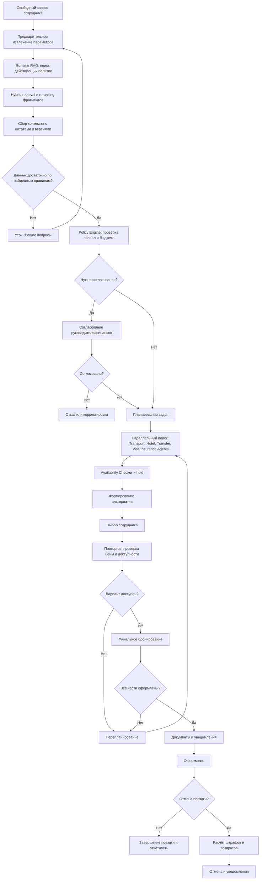

# HW3. Архитектура мультиагентной системы оформления командировок

## 1. Назначение продукта

Система автоматизирует оформление командировок от свободного текстового запроса сотрудника до бронирования, согласования, оформления и последующей отмены поездки. Правила не зашиты в коде: RAG-подсистема загружает и индексирует нормативные документы компании, а runtime-поиск извлекает действующие фрагменты с provenance. Детерминированный policy engine применяет найденные ограничения с обязательной ссылкой на документ, версию и пункт.

Целевой результат — согласованный и исполнимый план командировки, набор проверенных вариантов поездки и выполненное бронирование в пределах политики, бюджета и полномочий сотрудника.

## 2. Возможности

- Приём свободного текста, голосового ввода или структурированных полей.
- Извлечение намерения и параметров: город/страна, даты, длительность, задача, бюджет, предпочтения, участники.
- Поиск обязательных данных и формирование уточняющих вопросов.
- Загрузка нормативных документов из корпоративного хранилища, выделение версий, дат действия, области применимости и provenance.
- RAG-поиск применимых фрагментов с hybrid retrieval, reranking и цитатами; автоматическая переиндексация при публикации новой версии.
- Проверка командировки по лимитам, маршрутам, классу билета, допустимым отелям, визам, суточным и согласованиям на основе найденного RAG-контекста.
- Формирование плана: согласования и параллельные задачи специализированным агентам поиска транспорта, отеля, трансфера, визы/страховки.
- Работа `Booking Agent` через детерминированный Booking Service: поиск доступности, временная фиксация/hold, повторная проверка и финальное оформление.
- Работа `Cancellation & Refund Agent` через Cancellation Service: расчёт штрафов, отмена броней и контроль возвратов.
- Работа `Replanning Agent` при изменении цены, потере брони, истечении hold или частичном успехе.
- Формирование нескольких сопоставимых альтернатив с ценой, рисками, условиями возврата и ссылками на правила.
- Получение явного подтверждения пользователя перед покупкой.
- Идемпотентное финальное бронирование, оформление документов и уведомление.
- Перепланирование при истечении hold, изменении цены, недоступности или частичном сбое.
- Отмена поездки после оформления с расчётом штрафов и запуском возвратов.
- Аудит решений, версий документов, согласий пользователя и вызовов внешних систем.

## 3. Участники и границы

| Участник | Ответственность |
|---|---|
| Сотрудник | Описывает поездку, отвечает на вопросы, выбирает вариант, подтверждает покупку или отмену. |
| Руководитель | Согласует цель, бюджет и факт командировки по матрице полномочий. |
| Финансы / бухгалтерия | Проверяет бюджет, cost center, авансовый отчёт и финансовые лимиты. |
| Travel manager | Обрабатывает исключения, ручные согласования и спорные случаи. |
| HR / администратор политик | Публикует нормативные документы и правила их действия. |
| Агент командировки | Оркестрирует процесс и отвечает за безопасный переход между стадиями. |
| Внешние поставщики | Авиакомпании/жд, отели, трансфер, страхование и визовые сервисы. |

Система не принимает финансовое решение на основании одной LLM-реплики. LLM отвечает за понимание текста, формирование вопросов и объяснение, а соответствие правилам проверяется детерминированным policy engine. Специализированные агенты ищут предложения в своих доменах, но не выполняют финансовые операции напрямую. Hold, покупка, отмена и возврат выполняются детерминированным сервисом через типизированные адаптеры поставщиков; покупка всегда требует явного подтверждения пользователя.

## 4. Специализированные агенты и сервисы операций

| Агент | Зона ответственности | Что выполняет сервис, а не агент |
|---|---|---|
| `Transport Search Agent` | Ищет билеты, учитывает маршрут, багаж, тариф и возвратность | Hold, оплата, финальное бронирование и отмена через provider adapter |
| `Hotel Search Agent` | Ищет размещение по датам, лимитам, расположению и условиям отмены | Создание/отмена брони и возврат средств |
| `Transfer Search Agent` | Подбирает трансфер с учётом стыковок и времени прибытия | Идемпотентное подтверждение и платёж |
| `Visa & Insurance Agent` | Определяет применимость визы/страховки и ищет услуги | Покупка полиса/услуги и проверка статуса |
| `Booking Agent` | Координирует выбранную альтернативу и повторную проверку перед покупкой | `Booking & Compensation Service` выполняет hold/book/status |
| `Cancellation & Refund Agent` | Формирует запрос отмены, объясняет штраф и контролирует процесс | `Cancellation Manager` выполняет cancel/refund |
| `Replanning Agent` | Классифицирует сбой, меняет ограничения и выбирает следующий маршрут графа | Оркестратор и Saga выполняют переходы и компенсации |

Агенты разделены по доменам, чтобы каждый имел узкий prompt, набор разрешённых tools и понятные критерии качества. Агент не получает прямой доступ к платёжным данным и не вызывает поставщика без проверки прав и состояния кейса. Операционные сервисы являются детерминированными и идемпотентными, что защищает от повторной покупки, двойной отмены и неконсистентного частичного бронирования.

## 5. Обмен сообщениями между агентами

Агенты не ведут произвольный прямой чат друг с другом. Обмен происходит через LangGraph: оркестратор запускает node, node читает общий типизированный `TripState` и возвращает частичное обновление состояния. Следующий агент получает результат через state channel после перехода графа.

### Логический контракт сообщения

В production каждое межагентное сообщение представляется envelope:

```python
class AgentMessage(TypedDict):
    case_id: str
    run_id: str
    sender: str
    recipient: str
    message_type: str
    payload: dict[str, Any]
    policy_snapshot: list[PolicyChunk]
    correlation_id: str
    idempotency_key: str | None
```

В текущем LangGraph-прототипе envelope не выделен отдельным классом: его поля распределены между `TripState`, `Send` payload и `audit`. Это упрощение не меняет маршрутизацию и должно быть устранено при выделении production message bus.

### Каналы обмена

| Канал | Отправитель → получатель | Содержимое |
|---|---|---|
| `trip` state | `Request Parser Agent` → RAG/policy nodes | Нормализованный `TripRequest`, confidence и неоднозначности |
| `policy_context` | RAG Retriever → Completeness Checker / Policy Engine | `PolicyChunk` с `policy_id`, версией, citation и content hash |
| `human_interrupt` | Оркестратор → сотрудник/согласующий | Вопрос, список альтернатив или запрос подтверждения; ответ возвращается через `Command(resume=...)` |
| `search_task` | Planner → специализированный search agent | `SearchTask`, `TripRequest`, policy snapshot и ограничения |
| `search_results` | Search agent → fan-in barrier | Нормализованные `Offer`, статус задачи и ошибка |
| `booking_command` | Booking Agent → Booking Service | Выбранные offer IDs, hold, idempotency key; не платёжные реквизиты |
| `replan_event` | Booking/Provider → Replanning Agent | Причина сбоя, частичные результаты, provider reference и допустимые действия |
| `audit` | Все nodes/agents → Audit Store | Переход, actor, correlation ID, policy refs и результат операции |

### Пример обмена для командировки

1. `Request Parser Agent` возвращает `trip={destination: "Берлин", purpose: "встреча"}` в state.
2. `Policy RAG` помещает в `policy_context` chunks правил поездки и международных документов.
3. `Completeness Checker` читает `trip` и `policy_context`, формирует `missing_fields=[dates, budget, passport_data_or_visa_status]`.
4. `Clarification Manager` вызывает `interrupt`; ответ сотрудника возобновляет тот же граф по `thread_id=case_id`.
5. После повторного RAG и policy check `Travel Plan Builder` создаёт `SearchTask` для транспорта, отеля, трансфера и визы.
6. `Send("search_worker", task)` запускает отдельные worker-вызовы. `Transport Search Agent` возвращает offers только в `search_results`; `Hotel Search Agent` не изменяет транспортный результат напрямую.
7. Fan-in собирает результаты, `Alternative Builder` формирует варианты, а `Selection & Confirmation` передаёт выбранный `alternative_id` в booking graph.
8. `Booking Agent` посылает типизированную команду Booking Service. При `price_changed`, `expired_hold` или `partial_booking` создаётся `replan_event`, и `Replanning Agent` выбирает повторный поиск или manual review.

Таким образом, общий state является источником истины для одного запуска, LangGraph edges определяют порядок, `Send` — параллельность, `interrupt/Command` — человеко-машинный обмен, а внешние операции выполняются только через сервисные tools.

## 6. Высокоуровневый процесс




## 7. RAG: наполнение и применение

### 7.1. Контур наполнения из корпоративного хранилища

1. `Policy Ingestor` получает опубликованный документ и его metadata: `policy_id`, `version`, `effective_from`, `effective_to`, подразделение, страна и тип поездки.
2. Извлекаются текст, таблицы и заголовки из PDF/DOCX/HTML; исходный файл сохраняется в неизменяемом object storage.
3. `Document Normalizer & Chunker` очищает текст и делит его на фрагменты по смысловым границам. Каждый chunk сохраняет provenance: файл, страницу, раздел, пункт и хэш.
4. `Embedding Generator` строит embeddings, а `Policy Indexer` записывает одновременно vector index и keyword/full-text index.
5. Новая версия проходит валидацию, тестовые policy cases и становится `active` только после публикации администратором. Старая версия не удаляется и используется для воспроизводимости исторических решений.

### 7.2. Runtime-применение RAG в оформлении

RAG runtime вызывается до принятия решения о достаточности данных. Одного пользовательского текста недостаточно: только действующие правила определяют обязательные поля, например цель, cost center, состав участников, визу, согласование или тип подтверждающих документов.

1. `Request Parser` выполняет предварительное извлечение известных параметров из текста без утверждения, что набор данных полный.
2. Система строит retrieval query из известных параметров поездки и контекста сотрудника: подразделения, страны/города, дат, цели, бюджета и типа услуг.
3. `Hybrid Policy Retriever` выполняет keyword + vector поиск, фильтруя фрагменты по effective dates и области применимости.
4. `Policy Reranker` сортирует кандидатов; `RAG Context Assembler` собирает ограниченный контекст с цитатами и provenance.
5. `Completeness Checker` сопоставляет поля `TripRequest` с требованиями найденных политик и формирует missing/ambiguous fields. Если данных недостаточно, граф приостанавливается на уточняющих вопросах.
6. После ответа пользователя RAG-поиск и проверка полноты выполняются повторно, потому что новые данные могут изменить применимый набор норм.
7. Только после `complete` `Policy Rules Engine` преобразует контекст в типизированные решения `allowed`, `denied` или `conditional`: лимиты, классы, согласования, визы, суточные и возвратность.
8. В state сохраняются найденные fragments, `policy_id`, версия, rule code, citation и входные значения. LLM может объяснить решение, но не может изменить policy decision.
9. Если релевантный контекст не найден, документы противоречивы или действующая версия отсутствует, автоматическое бронирование запрещается и кейс переводится в `manual_review`.

### 7.3. Граница ingestion и runtime

Ingestion нормативных документов — отдельный административный/фоновой процесс, не входящий в жизненный цикл конкретной командировки. Он запускается по событию публикации документа, расписанию или ручной команде администратора политик. Результат ingestion — опубликованная версия в Policy Knowledge Base; пользовательский кейс только читает эту версию.

Runtime RAG является частью каждого нового policy check и перепланирования. Он не переиндексирует документы и не меняет базу знаний: его задача — найти применимые опубликованные chunks и передать их в Policy Engine. Это разделение позволяет обновлять политики независимо от активных командировок и сохранять воспроизводимость исторических решений.

### 7.4. Контроль качества RAG

- offline-набор вопросов с эталонными policy fragments и regression-тестами;
- проверка effective dates, области применимости и отсутствия конфликтующих активных версий;
- обязательные citations для каждого ограничения;
- метрики retrieval recall@k, citation coverage, policy decision accuracy и доля manual review;
- запрет использования неподтверждённого LLM-текста как нормативного правила.

## 8. Принципы решения

1. **Policy-as-data.** Документы хранятся с версией, периодом действия, областью применимости и метаданными. RAG помогает найти нормы, но окончательное решение принимает Policy Engine.
2. **Human-in-the-loop.** Уточнения, исключения, выбор альтернативы, покупка и отмена — точки, где требуется действие человека.
3. **Параллельное выполнение.** Независимые поисковые задачи запускаются через fan-out/fan-in LangGraph; переход дальше разрешён только после обработки результатов всех обязательных задач.
4. **Компенсирующие действия.** При частичном бронировании система не делает молчаливый rollback: сохраняет результат, запускает отмену уже созданных броней и предлагает перепланирование.
5. **Idempotency и hold.** Каждая операция поставщика имеет `idempotency_key`, TTL временной фиксации и повторную проверку перед оплатой.
6. **Безопасность.** Минимизация ПДн, секреты в secret manager, RBAC, шифрование, аудит без токенов и платёжных реквизитов.
7. **Объяснимость.** Каждая проверка содержит `policy_id`, версию документа, цитату/пункт и вычисленные значения.

## 9. Инварианты процесса

- Нельзя бронировать, пока обязательные поля не заполнены и политика не проверена.
- Нельзя покупать без явного подтверждения пользователя на конкретную альтернативу.
- Нельзя завершить оформление, если обязательная часть маршрута не подтверждена поставщиком.
- Нельзя считать результат согласованным по устаревшей версии политики.
- При истечении hold или изменении цены пользователь получает новую альтернативу, а не автоматическую покупку.
- При отмене система показывает возвратную сумму и штрафы до подтверждения отмены.

## 10. Результат и критерии готовности

Для каждой поездки сохраняется `TripCase`: исходный запрос, нормализованные параметры, применённые нормы, вопросы и ответы, план, альтернативы, согласования, брони, платежные статусы, документы, события перепланирования и аудит.

MVP считается готовым, если система обрабатывает авиабилет + отель, задаёт вопросы по неполным данным, применяет загруженную политику, выдаёт минимум две альтернативы, требует подтверждение, переживает истечение hold через перепланирование и поддерживает отмену с расчётом штрафа. Все переходы должны быть воспроизводимыми по audit trail.

## 11. Подготовка к реализации на LangGraph

### Графы

- `policy_ingestion_graph` — загрузка документа → извлечение текста → нормализация/chunking → embeddings → индексация → quality gates → публикация версии.
- `intake_graph` — parse request → RAG policy retrieval → missing-fields detector → clarification loop.
- `planning_graph` — RAG context → policy validation → approval planning → task fan-out/fan-in → alternatives.
- `booking_graph` — user selection → revalidation → idempotent booking → compensation/replan.
- `cancellation_graph` — load itinerary → calculate penalties → user confirmation → cancel/refund → notify.

### Состояние

```python
class TripState(TypedDict):
    case_id: str
    user_id: str
    request_text: str
    trip: TripRequest | None
    missing_fields: list[str]
    questions: list[Question]
    answers: dict[str, str]
    policy_refs: list[PolicyReference]
    policy_context_snapshot: list[PolicyChunk]
    policy_decisions: list[PolicyDecision]
    approvals: list[Approval]
    plan: TravelPlan | None
    search_tasks: list[SearchTask]
    search_results: list[SearchResult]
    alternatives: list[Alternative]
    selected_alternative_id: str | None
    holds: list[Hold]
    bookings: list[Booking]
    error: WorkflowError | None
    next_action: str
    audit_event_ids: list[str]
```

### Узлы и маршрутизация

- `parse_request` → `check_completeness` → `ask_clarification` или `retrieve_policies`.
- `policy_retrieval` → `policy_evaluator` → `create_approval_plan` или `create_search_plan`.
- `dispatch_search_tasks` запускает workers: `transport_search`, `hotel_search`, `transfer_search`, `visa_insurance_search`.
- `collect_search_results` → `availability_checker` → `alternative_builder`.
- `await_user_selection` — interrupt/resume с persisted checkpoint.
- `revalidate_selection` → `booking_coordinator` → `document_issuer` → `notify_user`.
- `replan_router` возвращает управление к поиску или к согласованию при изменении условий.
- `cancellation_policy` → `refund_calculator` → `await_cancel_confirmation` → `cancellation_coordinator`.

### Технические требования к реализации

- Checkpointer: PostgreSQL для возобновления после human interrupt и падения процесса.
- Event store: append-only audit events с correlation/case ID.
- Очередь задач: для долгих поисков и webhook callbacks поставщиков.
- Адаптеры поставщиков изолированы интерфейсом `TravelProviderAdapter`.
- LLM outputs всегда валидируются Pydantic/JSON Schema; недостоверные значения не попадают напрямую в booking API.
- Policy retrieval использует hybrid search, а Policy Engine — структурированные правила и effective dates.
- Тестирование: сценарии с истечением hold, price change, partial booking, duplicate webhook, отказом и отменой.
