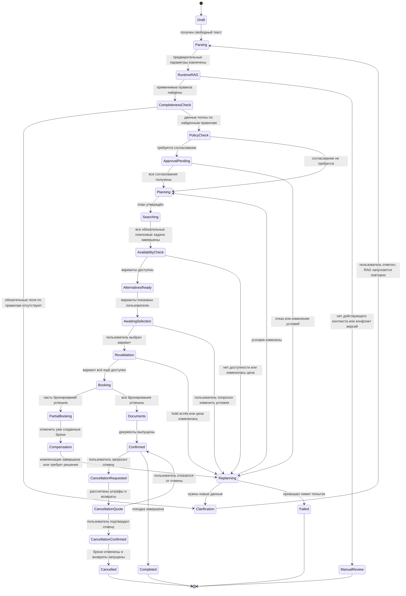
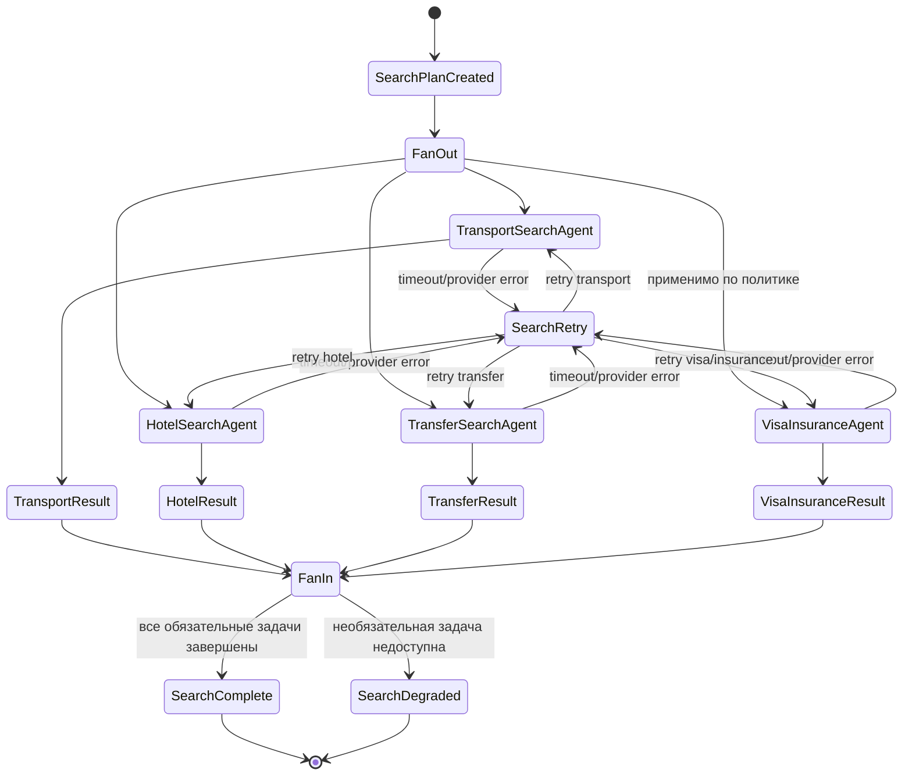
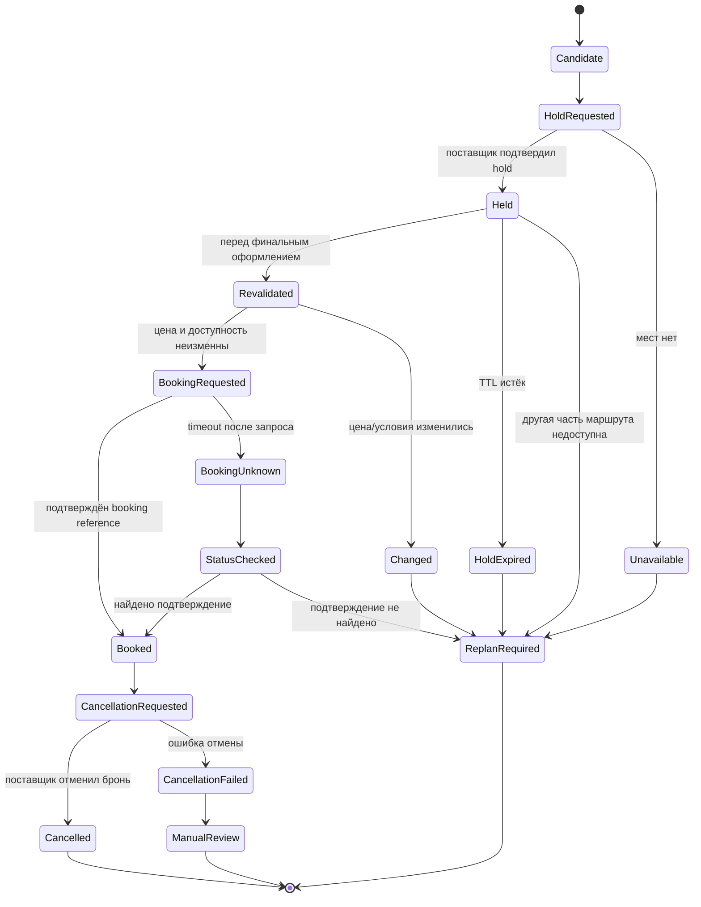
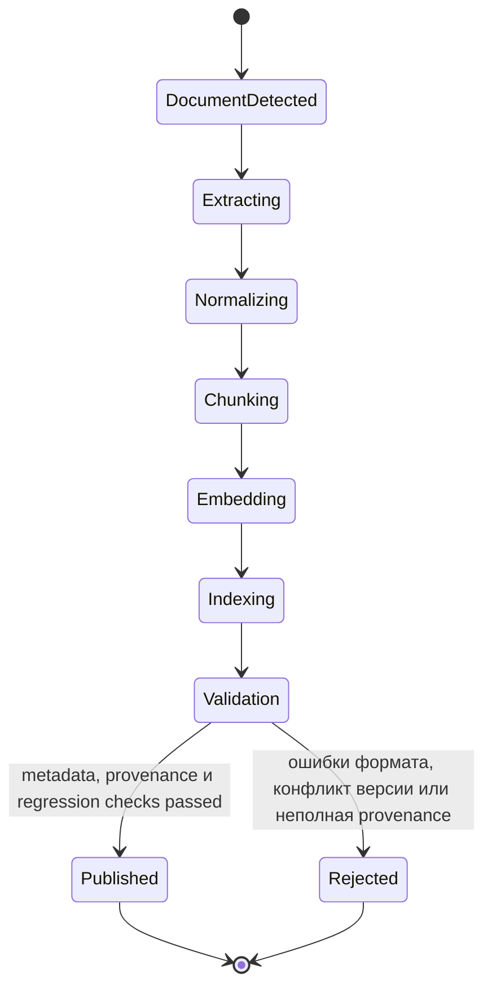
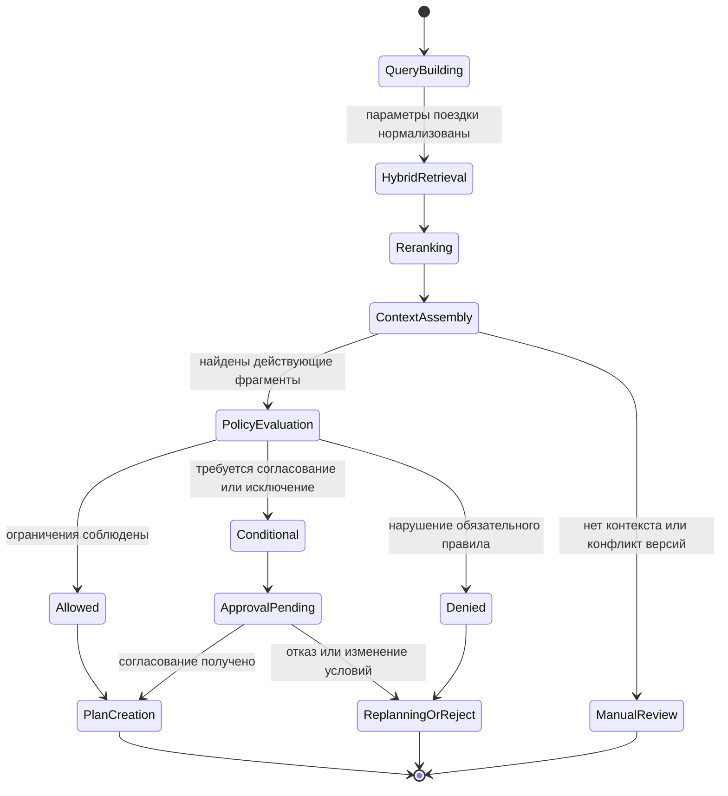

# Диаграммы состояний системы оформления командировок

## Жизненный цикл командировки

## Состояние параллельного поиска

## Состояние отдельной брони

За переходами `Revalidated → BookingRequested` и `CancellationRequested → Cancelled` стоят специализированные `Booking Agent` и `Cancellation & Refund Agent`. Они принимают решение о следующем действии, но фактические операции выполняются детерминированными компонентами Booking Service.

## Наполнение RAG нормативными документами

## Runtime-поиск и применение RAG

## Связь диаграмм

Наполнение RAG не является частью каждого пользовательского запроса: это отдельный управляемый контур, который обновляет базу знаний. Основной workflow использует только опубликованные версии документов. В состоянии `PolicyCheck` запускается runtime-поиск RAG, после чего результат поступает в `PolicyEvaluation`; при отсутствии проверяемого контекста автоматическое бронирование блокируется и создаётся `ManualReview`.

Жизненный цикл командировки является родительским. В состоянии `Searching` раскрывается диаграмма параллельного поиска. После `AvailabilityCheck` каждая найденная возможность представлена отдельной сущностью и проходит жизненный цикл брони. События `HoldExpired`, `Changed`, `Unavailable`, `BookingUnknown` и `PartialBooking` возвращают родительский процесс в `Replanning`. После `Confirmed` запускается тот же booking state machine в обратной ветке отмены.

Между состояниями действуют следующие связи:

| Контур | Вход | Результат | Использование |
|---|---|---|---|
| RAG ingestion | Новая/изменённая инструкция или регламент | Опубликованные chunks, embeddings, metadata и provenance | Доступно для будущих кейсов |
| RAG runtime | Нормализованный TripRequest | Релевантный контекст и ссылки на правила | Состояние `PolicyCheck` |
| Policy evaluation | RAG-контекст | `Allowed`, `Conditional`, `Denied` или `ManualReview` | Создание плана и согласований |
| Booking workflow | Выбранная альтернатива | Брони, документы или `Replanning` | Состояния `Booking` и `Confirmed` |
| Cancellation workflow | Подтверждённая поездка | Quote, отмена и возврат | Ветка после `Confirmed` |

При публикации новой версии RAG не изменяет уже завершённый кейс: историческое решение ссылается на зафиксированные `policy_id`, `version`, `citation` и хэш фрагмента. Новая версия применяется только к новым проверкам или явно запущенному перепланированию.
