# Архитектура агентной RAG-системы нормативной поддержки (C4)

Документ описывает целевую архитектуру корпоративной агентной RAG-системы для помощи
сотрудникам по нормативным документам (НД) крупной компании. Архитектура построена в
нотации C4 (уровни Context / Container / Component / Deployment). Отдельные документы:

- `02_Риски_ИБ_и_Наблюдаемость.md` — анализ рисков ИБ и проблемы наблюдаемости.
- `03_Отчёт_по_заданию.md` — отдельный отчёт по файлу задания (Security-схемы, план
  тестирования RAG, дашборд Grafana).

---

## 1. Назначение и границы системы

Система решает три класса задач:

1. **Интеллектуальный подбор нормативных документов** под комплексную постановку задачи,
   сформулированную пользователем на естественном языке (агентный многошаговый retrieval).
2. **Автоматическое заполнение стандартных отчётов** по данным пользователя в соответствии
   с требованиями, извлечёнными из НД.
3. **Управляемая загрузка и актуализация НД** с контролем качества, безопасности и
   атомарным переключением на новую версию индекса.

Ключевые архитектурные инварианты (обязательные требования):

| Код | Требование |
|-----|------------|
| R1  | Разделение доступа пользователей **на уровне векторной БД** (не только на уровне API). |
| R2  | Чанки в векторной БД хранятся **зашифрованными** (envelope encryption). |
| R3  | Обращение к LLM — только через **выделенный инференс**, доступ к которому защищён **выделенным сервисом Guardrails**. |
| R4  | Загрузка/актуализация НД — через **отдельный интерфейс** с проверкой на отравления и инъекции, настройкой парсинга/чанкинга и превью. |
| R5  | Корректность загрузки проверяется **до** переключения; переключение на новую БД — **атомарное** (blue/green). |
| R6  | Перед переключением **выделенный сервис** проверяет консистентность и корректность информации в RAG; по итогам формируются **дашборды с отчётами о тестировании**. |
| R7  | В рантайме ответы оцениваются по критериям **релевантности**; пользователи и администраторы **информируются** об ошибках. |
| R8  | Вопросы и ответы **санитизируются** от атак отравления данных и вирусов. |
| R9  | Guard защищает от **prompt injection** и некорректного использования **tool/function calling**. |
| R10 | Если у пользователя нет права на обработку ПДн — запросы с ПДн **автоматически маскируются**. |
| R11 | Существует **отдельная система инфраструктурного мониторинга** (разделена с AI-наблюдаемостью). |

---

## 2. C4 Level 1 — System Context

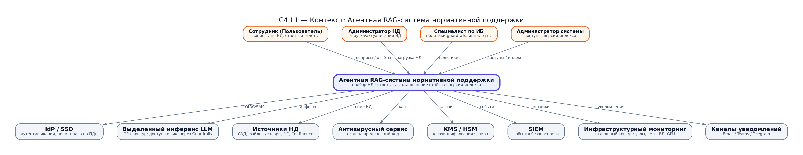

PNG · [SVG](diagrams/01_c4_l1_context.svg) · [Graphviz .dot](diagrams/src/01_c4_l1_context.dot)

Исходник диаграммы (mermaid)

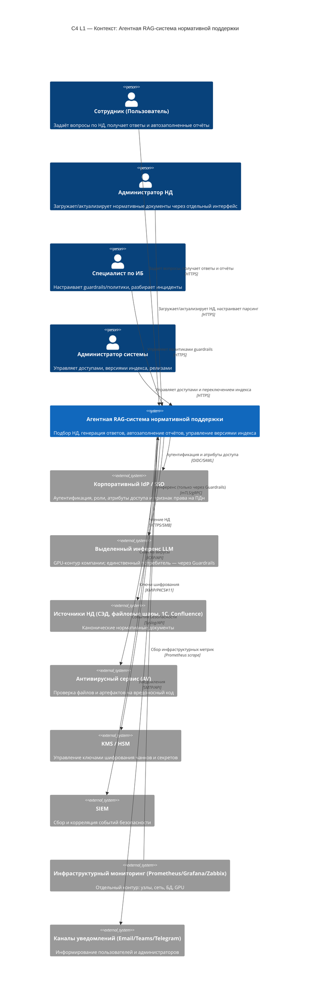

### Участники (акторы)

- **Сотрудник (Пользователь)** — основной потребитель: вопросы, разбор НД, автозаполнение
  отчётов, обратная связь о качестве ответов.
- **Администратор НД (Knowledge Manager)** — владелец контента: загрузка, версионирование,
  настройка парсинга/чанкинга, превью, инициирование переключения индекса.
- **Специалист по ИБ** — владелец политик безопасности: guardrails, правила маскирования ПДн,
  реакция на инциденты.
- **Администратор системы** — эксплуатация: доступы, релизы, версии активного индекса.

### Внешние системы

- **IdP/SSO** — источник истины по личности, ролям и атрибутам (в т.ч. право на ПДн).
- **Выделенный инференс LLM** — изолированный GPU-контур; сетевой доступ к нему разрешён
  только сервису Guardrails (сетевые политики + mTLS + allow-list).
- **Источники НД** — канонические документы; система их не изменяет, только читает.
- **AV-сервис**, **KMS/HSM**, **SIEM**, **каналы уведомлений** — сквозные корпоративные сервисы.
- **Инфраструктурный мониторинг** — отдельный контур (см. R11), не смешивается с AI-наблюдаемостью.

---

## 3. C4 Level 2 — Containers

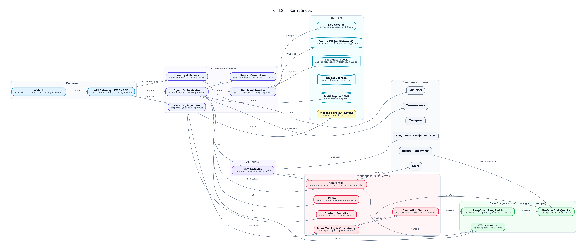

PNG · [SVG](diagrams/02_c4_l2_containers.svg) · [Graphviz .dot](diagrams/src/02_c4_l2_containers.dot)

Исходник диаграммы (mermaid)

```mermaid
C4Container
    title C4 L2 — Контейнеры: Агентная RAG-система

    Person(user, "Сотрудник")
    Person(km, "Администратор НД")
    Person(sec, "Специалист по ИБ")

    System_Boundary(edge, "Периметр") {
        Container(gw, "API Gateway / WAF / BFF", "Kong + NGINX", "TLS-терминация, WAF, rate limiting, маршрутизация, BFF для UI")
        Container(web, "Web UI", "React SPA", "Чат, редактор отчётов, портал загрузки НД, дашборды")
    }

    System_Boundary(app, "Прикладные сервисы") {
        Container(iam, "Identity & Access Service", "Keycloak-клиент + RBAC/ABAC", "Аутентификация, scoped-токены, вычисление тегов доступа и PII-группы")
        Container(orch, "Agent Orchestrator", "LangGraph/собственный агент, Python", "Планирование, tool-calling, многошаговый retrieval, сборка ответа")
        Container(retr, "Retrieval Service", "Python, hybrid search", "Векторный+BM25 поиск, реранкинг, применение ACL-фильтров")
        Container(reportgen, "Report Generation Service", "Python + шаблонизатор", "Автозаполнение стандартных отчётов по данным и требованиям НД")
        Container(curator, "Curator / Ingestion Service", "Python", "Оркестрация загрузки НД, версионирование, approval-воркфлоу")
    }

    System_Boundary(sec_layer, "Слой безопасности и качества") {
        Container(guard, "Guardrails Service", "Python, классификаторы", "Валидация входа/выхода, антиинъекции, политика tool-calling")
        Container(pii, "PII Sanitizer / Data Masking", "Python, NER-модель", "Детект и маскирование/токенизация ПДн по правам пользователя")
        Container(avscan, "Content Security Service", "AV-коннектор + poison-detector", "Скан на вирусы, детект отравления данных на входе и в Q&A")
        Container(indextest, "Index Testing & Consistency Service", "Python + тест-сьюты", "Проверка консистентности/корректности индекса перед переключением")
        Container(eval, "Evaluation Service (Ragas/DeepEval)", "Python", "Оффлайн/онлайн оценка Faithfulness, Answer Relevancy и др.")
    }

    System_Boundary(ai, "AI-контур") {
        Container(llmgw, "LLM Gateway", "Go/Python", "Единая точка вызова инференса, квоты, таймауты, fallback, mTLS")
    }

    System_Boundary(data, "Данные") {
        ContainerDb(vdb, "Vector DB (multi-tenant)", "Qdrant/Milvus", "Эмбеддинги; коллекции/партиции по группам доступа; зашифрованные payload")
        ContainerDb(meta, "Metadata & ACL Store", "PostgreSQL", "Метаданные документов, ACL чанков, версии, указатель активного индекса")
        ContainerDb(audit, "Audit Log Store", "OpenSearch/WORM S3", "Неизменяемый журнал действий и доступа")
        ContainerDb(objst, "Object Storage", "S3/MinIO", "Сырые документы, артефакты парсинга, снапшоты индекса")
        ContainerQueue(mq, "Message Broker", "Kafka", "Асинхронный конвейер ingestion и оценок")
        Container(kmsc, "Key Service", "Vault + KMIP", "Envelope-шифрование: KEK/DEK на чанк, ротация")
    }

    System_Boundary(obs, "AI-наблюдаемость (отдельно от инфры)") {
        Container(otel, "OTel Collector", "OTel", "Приём трасс/метрик/логов приложений")
        Container(aiobs, "AI Observability (Langfuse/LangSmith)", "Langfuse", "Трассы агента, промпты, оценки, стоимость")
        Container(graf, "Grafana (AI + Quality)", "Grafana", "Дашборды качества, тестов, стоимости, инцидентов")
    }

    System_Ext(idp, "IdP / SSO")
    System_Ext(llm, "Выделенный инференс LLM")
    System_Ext(av, "AV-сервис")
    System_Ext(siem, "SIEM")
    System_Ext(infra, "Инфраструктурный мониторинг")
    System_Ext(notify, "Каналы уведомлений")

    Rel(user, web, "Использует", "HTTPS")
    Rel(km, web, "Загружает НД", "HTTPS")
    Rel(sec, web, "Настраивает политики", "HTTPS")
    Rel(web, gw, "API-вызовы", "HTTPS/JSON")
    Rel(gw, iam, "Проверка токена/прав", "gRPC")
    Rel(gw, orch, "Маршрутизация запроса", "gRPC")
    Rel(gw, curator, "Маршрутизация ingestion", "gRPC")

    Rel(orch, guard, "Валидация входа/выхода, политика tools", "gRPC/mTLS")
    Rel(orch, pii, "Детект/маскирование ПДн", "gRPC/mTLS")
    Rel(orch, retr, "Поиск релевантных чанков", "gRPC/mTLS")
    Rel(orch, reportgen, "Заполнение отчёта", "gRPC")
    Rel(orch, llmgw, "Вызов LLM", "gRPC/mTLS")
    Rel(llmgw, guard, "Прогон политик guardrails", "gRPC")
    Rel(llmgw, llm, "Инференс", "mTLS/gRPC")
    Rel(retr, vdb, "Поиск с ACL-фильтром", "gRPC/mTLS")
    Rel(retr, meta, "ACL и метаданные", "SQL")
    Rel(retr, kmsc, "Расшифровка чанков", "KMIP")
    Rel(reportgen, retr, "Извлечение требований", "gRPC")
    Rel(reportgen, objst, "Шаблоны и данные", "S3")

    Rel(curator, avscan, "Скан файлов", "ICAP/API")
    Rel(curator, pii, "Детект ПДн в НД", "gRPC")
    Rel(curator, guard, "Антиинъекции в контенте", "gRPC")
    Rel(curator, indextest, "Запуск проверки перед переключением", "gRPC")
    Rel(curator, mq, "Публикация задач", "Kafka")
    Rel(indextest, eval, "Прогон тест-сьюта", "gRPC")
    Rel(indextest, graf, "Публикация отчётов тестирования", "API")

    Rel(orch, otel, "Трассы/метрики", "OTLP")
    Rel(guard, otel, "Трассы/метрики", "OTLP")
    Rel(eval, aiobs, "Оценки и трассы", "API")
    Rel(otel, aiobs, "Экспорт трасс", "OTLP")
    Rel(aiobs, graf, "Данные дашбордов", "API")
    Rel(orch, audit, "Журнал действий", "SQL")
    Rel(guard, siem, "События безопасности", "Syslog/API")
    Rel(infra, graf, "Инфраструктурные метрики (отдельный источник)", "Prometheus")

    Rel(iam, idp, "OIDC/SAML", "HTTPS")
    Rel(orch, notify, "Уведомления об ошибках", "API")
```

### Назначение контейнеров (ключевые)

- **API Gateway / WAF / BFF** — единая точка входа; TLS-терминация, WAF-правила (включая
  лимиты размера и структуры запроса), rate limiting, маршрутизация к BFF/сервисам.
- **Web UI** — SPA: чат по НД, редактор/просмотр автозаполненных отчётов, **портал загрузки
  НД** (настройка парсинга/чанкинга, превью, статус проверки), дашборды качества.
- **Identity & Access Service** — интеграция с IdP, выпуск **scoped-токенов** с тегами доступа
  (data-access tags) и флагом права на ПДн (`pii_allowed`); права вычисляются из ролей/атрибутов.
- **Agent Orchestrator** — «мозг»: строит план решения комплексной задачи, вызывает инструменты
  (retrieval, report, LLM) через Guardrails, ведёт сессию, собирает финальный ответ.
- **Retrieval Service** — гибридный поиск (dense + лексический) с реранкингом; **ACL-фильтр
  передаётся в векторную БД** (R1), расшифровка payload через Key Service (R2).
- **Report Generation Service** — сопоставляет требования из НД с полями шаблона отчёта и
  данными пользователя, формирует документ.
- **Curator / Ingestion Service** — конвейер загрузки: скан AV → poison/injection-проверка →
  парсинг → чанкинг → превью → проверка → атомарное переключение.
- **Guardrails Service** — выделенный сервис политик; **единственный разрешённый путь к
  инференсу** (R3, R9).
- **PII Sanitizer** — детект/маскирование/токенизация ПДн (R10).
- **Content Security Service** — AV + детект отравления данных на входе/выходе (R8).
- **Index Testing & Consistency Service** — предполётная проверка консистентности и корректности
  информации в RAG, запуск тест-сьютов, формирование отчётов/дашбордов (R6).
- **Evaluation Service (Ragas/DeepEval)** — оффлайн и онлайн метрики качества.
- **LLM Gateway** — единая точка вызова инференса, квоты, таймауты, ретраи, деградация.
- **Vector DB (multi-tenant)** — разделение доступа на уровне БД (коллекции/партиции по группам
  доступа), зашифрованные чанки (R1, R2).
- **Metadata & ACL Store** — метаданные, ACL чанков, версии, **указатель активного индекса**
  (атомарный переключатель).
- **Key Service** — envelope-шифрование (KEK/DEK), ротация ключей.
- **AI Observability** — трассы агента, промпты, оценки, стоимость; **отдельно** от инфраструктурного
  мониторинга (R11).

---

## 4. C4 Level 3 — Компоненты (ключевые контейнеры)

### 4.1 Agent Orchestrator

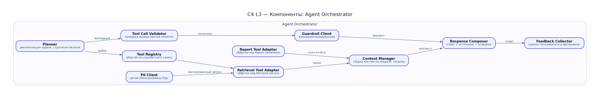

PNG · [SVG](diagrams/03_c4_l3_orchestrator.svg) · [Graphviz .dot](diagrams/src/03_c4_l3_orchestrator.dot)

Исходник диаграммы (mermaid)

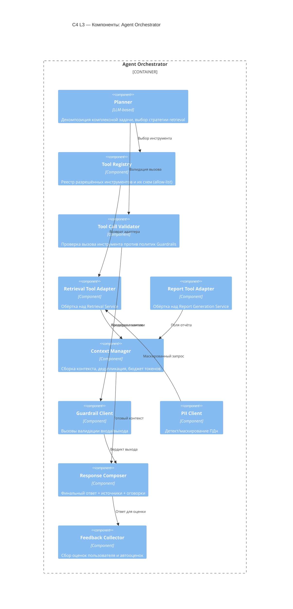

### 4.2 Guardrails Service

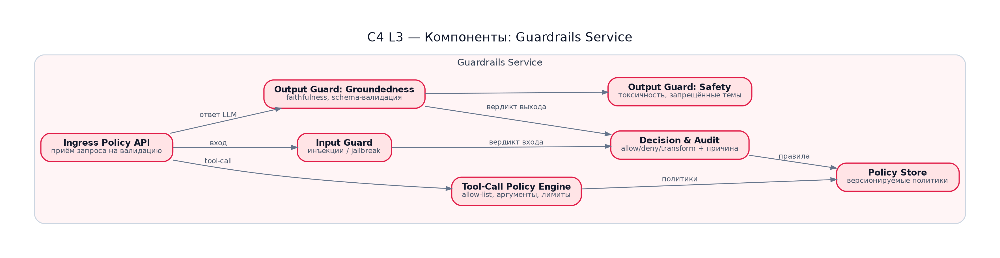

PNG · [SVG](diagrams/04_c4_l3_guardrails.svg) · [Graphviz .dot](diagrams/src/04_c4_l3_guardrails.dot)

Исходник диаграммы (mermaid)

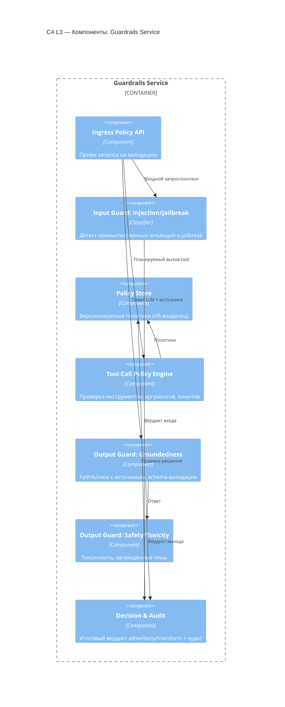

### 4.3 Curator / Ingestion (загрузка и актуализация НД)

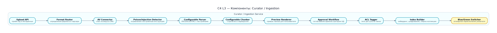

PNG · [SVG](diagrams/05_c4_l3_ingestion.svg) · [Graphviz .dot](diagrams/src/05_c4_l3_ingestion.dot)

Исходник диаграммы (mermaid)

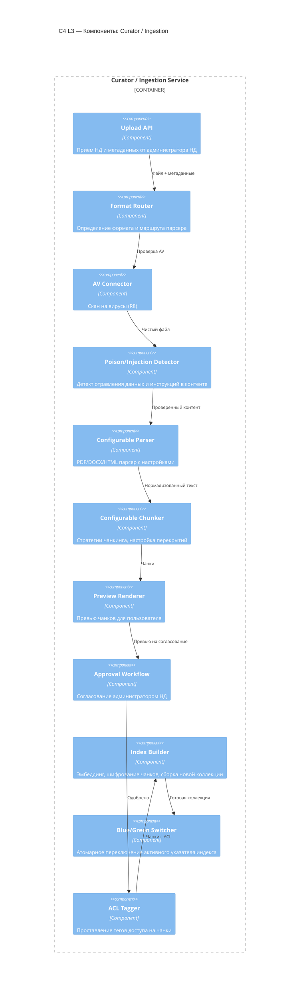

---

## 5. C4 Level 4 — Deployment

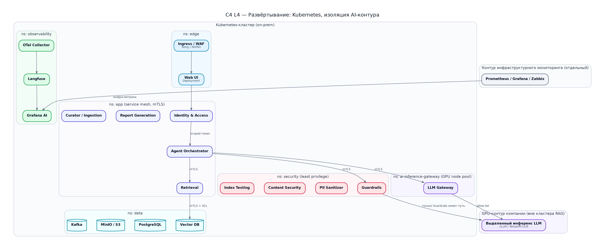

PNG · [SVG](diagrams/06_c4_l4_deployment.svg) · [Graphviz .dot](diagrams/src/06_c4_l4_deployment.dot)

Исходник диаграммы (mermaid)

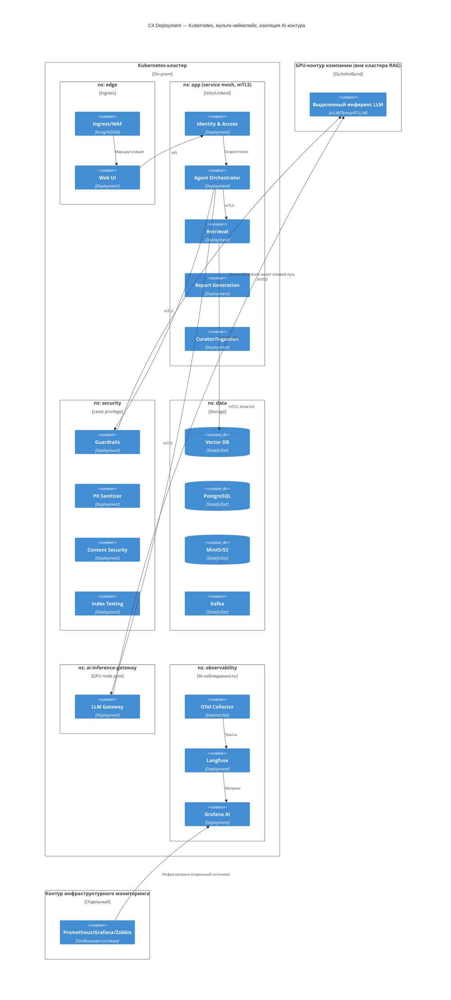

Ключевые решения по развёртыванию:

- **Service mesh (mTLS everywhere)** — весь сервис-сервис трафик аутентифицирован и шифрован.
- **ns: security** с least-privilege; **доступ к inference-контуру разрешён только Guardrails**
  (NetworkPolicy + allow-list + mTLS) — реализация R3.
- **GPU node pool** изолирован; LLM Gateway — единственный «мост».
- **AI-наблюдаемость отделена** от инфраструктурного мониторинга (R11) на уровне неймспейсов,
  хранилищ и доступов.
- **Vector DB** хранит зашифрованные payload; ключи — вне кластера (KMS/HSM, R2).
- **Blue/Green индексы** — две коллекции (active/candidate); переключение — атомарная смена
  указателя в Metadata Store.

---

## 6. Основные пользовательские сценарии

### Сценарий A. Вопрос по нормативным документам (базовый)

1. Пользователь авторизуется через SSO; Identity & Access выпускает **scoped-токен** с
   тегами доступа и флагом `pii_allowed`.
2. Пользователь задаёт вопрос в Web UI; запрос идёт через API Gateway/WAF.
3. Orchestrator вызывает **Content Security** (санитизация Q&A, R8) и **PII Sanitizer**
   (маскирование ПДн, если нет права, R10).
4. Orchestrator через **Guardrails** валидирует входной запрос (антиинъекции/jailbreak, R9).
5. Retrieval выполняет гибридный поиск; **ACL-фильтр уходит в векторную БД** (R1); payload
   расшифровывается Key Service (R2).
6. Контекст собирается и отправляется в **LLM Gateway → Guardrails → выделенный инференс** (R3).
7. Ответ проходит Output Guard (groundedness/safety), возвращается с источниками.
8. **Evaluation Service** оценивает ответ по релевантности; при низком скоров пользователь
   и администратор **информируются** (R7); оценка и трасса пишутся в AI-наблюдаемость.

### Сценарий B. Комплексная постановка задачи → подбор НД

1. Пользователь формулирует комплексную задачу (несколько требований, разные НД).
2. Planner декомпозирует задачу на подвопросы и строит стратегию retrieval.
3. Выполняется **несколько итераций** поиска (multi-hop): уточняющие запросы, добор документов.
4. Context Manager ранжирует и дедуплицирует чанки, укладываясь в бюджет токенов.
5. Формируется структурированный ответ: перечень применимых НД, цитаты, пробелы/риски.

### Сценарий C. Автозаполнение стандартного отчёта

1. Пользователь выбирает тип отчёта и указывает данные (или источник данных).
2. Report Generation через Retrieval извлекает требования НД к отчёту.
3. Сервис сопоставляет требования с полями шаблона и данными пользователя.
4. Оркестратор при неоднозначностях запрашивает у пользователя уточнения (human-in-the-loop).
5. Заполненный отчёт проходит Output Guard (проверка на выдуманные поля/несоответствия).
6. Реквизиты ПДн маскируются, если у пользователя нет прав (R10); отчёт сохраняется и логируется.

### Сценарий D. Загрузка и актуализация НД (curator)

1. Администратор НД загружает документ через **отдельный интерфейс** и задаёт настройки
   парсинга/чанкинга (R4).
2. **Content Security** сканирует файл на вирусы; **Poison/Injection Detector** ищет
   отравление данных и встроенные инструкции (R8).
3. Документ парсится и чанкуется; формируется **превью** чанков для пользователя (R4).
4. Администратор проверяет превью и подтверждает; чанкам проставляются **ACL-теги**, чанки
   шифруются, собирается **candidate-индекс** (R2).
5. **Index Testing & Consistency Service** проверяет консистентность и корректность информации
   в RAG, прогоняет тест-сьют (Faithfulness/Answer Relevancy и др.) (R6).
6. Результаты публикуются на **дашборды с отчётами о тестировании** (R6).
7. При успешном прохождении порогов — **атомарное переключение** на candidate-индекс
   (Blue/Green) (R5). При провале — переключение блокируется, администратор уведомляется.

### Сценарий E. Реакция на инцидент/ошибку качества

1. Evaluation Service или пользовательская обратная связь фиксирует проблемный ответ (R7).
2. Уведомление уходит пользователю и администратору; создаётся запись в AI-наблюдаемости.
3. Специалист по ИБ видит событие в SIEM; при подтверждении атаки корректирует политики
   Guardrails/PII (versioned Policy Store).
4. При необходимости инициируется переоценка индекса и/или откат на предыдущую версию.

---

## 7. Сводка принятых архитектурных решений (ADR-подобно)

| # | Решение | Обоснование |
|---|---------|-------------|
| D1 | Разделение доступа на уровне векторной БД (коллекции/партиции + ACL-фильтр) | Требование R1; защита от утечки при ошибке в прикладном слое |
| D2 | Envelope-шифрование чанков, ключи в KMS/HSM | Требование R2; компрометация диска/бэкапа не раскрывает данные |
| D3 | Guardrails как единственный шлюз к инференсу | R3, R9; централизованные политики, единая точка аудита |
| D4 | Blue/Green индекс + атомарный указатель в Metadata Store | R5; нулевой простой и безопасный откат |
| D5 | Отдельный предполётный сервис проверки RAG + дашборды | R6; проверка до переключения, а не после |
| D6 | Оценочный конвейер (Ragas/DeepEval) онлайн + оффлайн | R7; качество измеряется постоянно, а не только при релизе |
| D7 | Отделение AI-наблюдаемости от инфраструктурного мониторинга | R11; разные владельцы, разные данные, разные SLA |
| D8 | PII Sanitizer по правам пользователя | R10; соответствие требованиям о персональных данных |
