# Отчёт по заданию: «Комплексное обеспечение качества: Тестирование, Безопасность и Наблюдаемость»

Домашнее задание выполнено по файлу `задание`. Цель — спроектировать комплекс обеспечения
качества AI-системы, включающий безопасность, тестирование RAG и наблюдаемость с AI-метриками.

Объект: агентная RAG-система нормативной поддержки (см. `01_C4_Архитектура.md`).

Формат сдачи (по заданию):

1. Схемы Security.
2. План тестирования.
3. Мокап/список виджетов дашборда.

---

## 1. Security Layer

### 1.1. Общая схема защиты (Security Architecture)

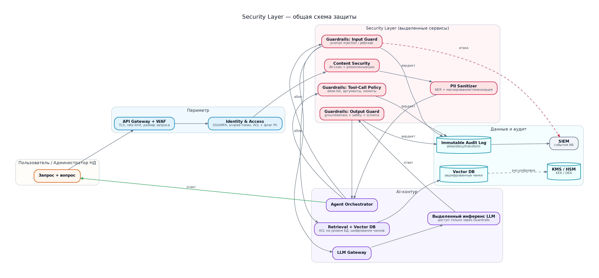

PNG · [SVG](diagrams/sec_architecture.svg) · [Graphviz .dot](diagrams/src/sec_architecture.dot)

Исходник диаграммы (mermaid)

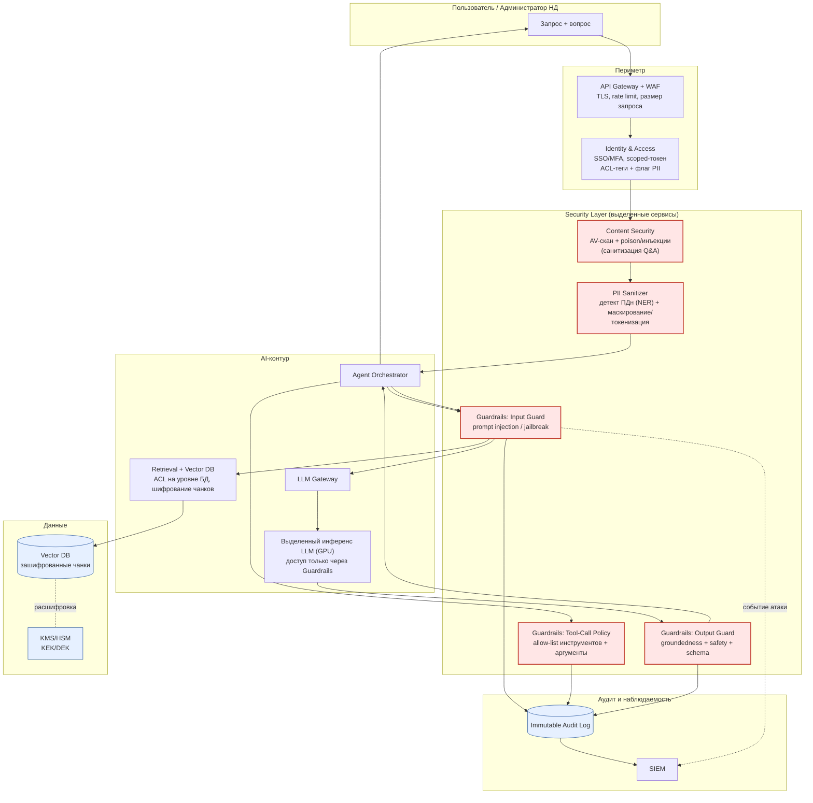

**Сквозные принципы**: deny-by-default; data ≠ instructions; единый шлюз к инференсу;
иммутабельный аудит; defense in depth (сеть + приложение + БД).

### 1.2. PII Sanitizer — скрытие персональных данных перед отправкой в LLM

Назначение: не дать ПДн (и иным защищённым категориям) попасть в LLM/логи/трассы, если у
пользователя нет права на обработку ПДн (требование R10).

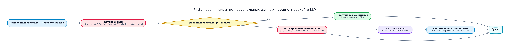

PNG · [SVG](diagrams/pii_sanitizer.svg) · [Graphviz .dot](diagrams/src/pii_sanitizer.dot)

Исходник диаграммы (mermaid)

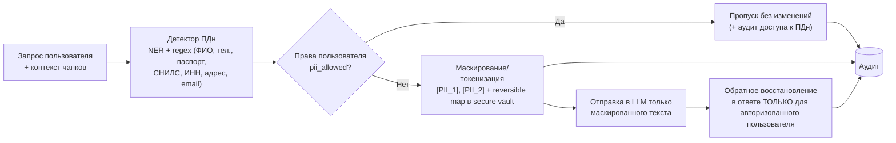

Особенности:
- **Маскирование вместо удаления** — сохраняется связность диалога (токены `[PII_n]`).
- **Reversible map** хранится отдельно, с шифрованием и коротким TTL; в LLM не уходит.
- Детект выполняется **и на входе (запрос/контекст), и на выходе** (ответ), а также при
  загрузке НД (ПДн внутри документов).
- Маскирование применяется **до** записи в трассы/логи наблюдаемости (иначе вторичная утечка).

### 1.3. Guardrails — валидация ответов и защита от инъекций и злоупотребления инструментами

Покрываемые атаки: **prompt injection** (прямая и косвенная), jailbreak, некорректное
использование **tool/function calling**, утечка через вывод, небезопасная обработка вывода.

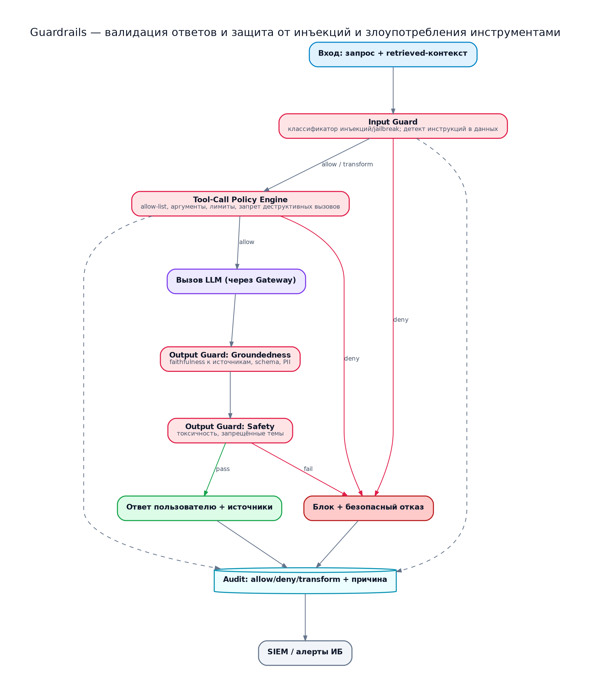

PNG · [SVG](diagrams/guardrails_flow.svg) · [Graphviz .dot](diagrams/src/guardrails_flow.dot)

Исходник диаграммы (mermaid)

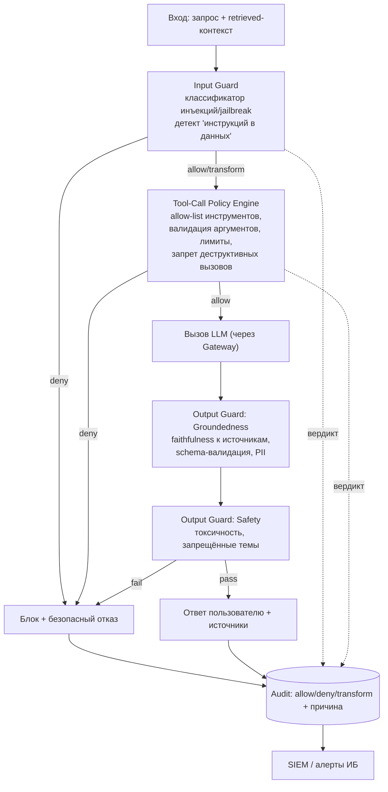

Ключевые правила:
- **Indirect prompt injection**: контент НД всегда оборачивается как **данные**, не как
  инструкции; детекторы ищут «инструкции внутри документа» и скрытый текст.
- **Tool-calling**: инструменты только из **allow-list**; проверяется схема и значения
  аргументов; опасные действия — с подтверждением (human-in-the-loop).
- **Output**: ответ валидируется на **groundedness** (нет ли выдуманных положений НД) и
  безопасность; проверка структуры (schema) для автозаполнения отчётов.
- Все вердикты (allow/deny/transform + причина) — в **неизменяемый аудит** и SIEM.

### 1.4. Как учтены специфичные атаки (критерий оценки)

| Атака | Где закрывается |
|-------|-----------------|
| Прямая prompt injection / jailbreak | Guardrails Input Guard (классификаторы + правила) |
| Косвенная инъекция через НД | Poison/Injection Detector на ingestion + «data ≠ instructions» + превью/согласование |
| Отравление RAG | Предполётная проверка консистентности (R6) + версионирование + откат |
| Утечка ПДн в LLM/логи | PII Sanitizer + маскирование телеметрии + запрет ПДн в observability-хранилище |
| Обход разделения доступа | ACL на уровне векторной БД (R1) + deny-by-default |
| Злоупотребление tool/function calling | Tool-Call Policy Engine (allow-list, аргументы, лимиты) |
| Небезопасная обработка вывода | Output Guard + экранирование в UI, запрет исполнения кода из ответа |
| Утечка чанков/ключей | Envelope-шифрование + KMS/HSM + шифрование бэкапов |

Маппинг на **OWASP Top 10 for LLM (2025)**: LLM01 (Injection), LLM02 (Insecure Output),
LLM03 (Training Data Poisoning), LLM06 (Sensitive Info Disclosure), LLM07 (Insecure Plugin),
LLM08 (Excessive Agency), LLM10 (Model Theft) — см. `02_Риски_ИБ_и_Наблюдаемость.md`, п.1.4.

---

## 2. Testing Strategy — оценка качества RAG

### 2.1. Инструмент

Выбор: **Ragas** (основной, метрики RAG «из коробки») + **DeepEval** (дополнительно:
unit-тесты LLM, red teaming, CI-интеграция). Дополняют друг друга:

- **Ragas** — эталонные метрики RAG: `faithfulness`, `answer_relevancy`,
  `context_precision`, `context_recall`, `context_entity_recall`, `answer_correctness`,
  `answer_similarity`.
- **DeepEval** — LLM-юнит-тесты, G-Eval, hallucination, bias/toxicity, **red teaming**
  (prompt injection), интеграция в CI с порогами.

Судейство: **LLM-as-judge** (отдельная модель-судья, желательно не та, что генерирует ответ),
калиброванная на экспертной разметке; плюс выборочная экспертная валидация.

### 2.2. Ключевые метрики

| Метрика | Что измеряет | Целевой порог | Уровень |
|---------|--------------|---------------|---------|
| **Faithfulness** | Ответ опирается на контекст, без галлюцинаций | ≥ 0.90 | RAG-ответ |
| **Answer Relevancy** | Ответ релевантен вопросу | ≥ 0.85 | RAG-ответ |
| Context Precision | Точность найденного контекста | ≥ 0.80 | Retrieval |
| Context Recall | Полнота найденного контекста | ≥ 0.80 | Retrieval |
| Answer Correctness | Совпадение с эталоном | ≥ 0.80 | RAG-ответ |
| Hallucination Rate | Доля неподтверждённых утверждений | ≤ 0.05 | RAG-ответ |
| Groundedness (guard) | Вердикт Output Guard | ≥ 0.95 pass | Безопасность |
| Injection Detection (P/R) | Precision/Recall детекции атак | P ≥ 0.9, R ≥ 0.95 | Безопасность |
| Answer Relevancy (онлайн) | Качество в проде | ≥ 0.85 | Прод |

Обязательные по заданию — **Faithfulness** и **Answer Relevancy** — выделены жирным.

### 2.3. Уровни и виды тестирования

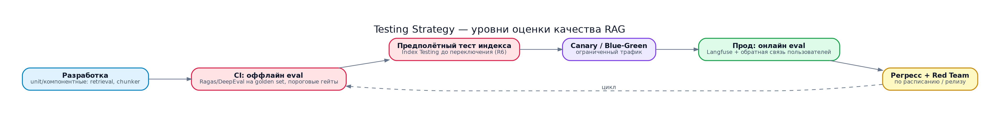

PNG · [SVG](diagrams/test_pipeline.svg) · [Graphviz .dot](diagrams/src/test_pipeline.dot)

Исходник диаграммы (mermaid)

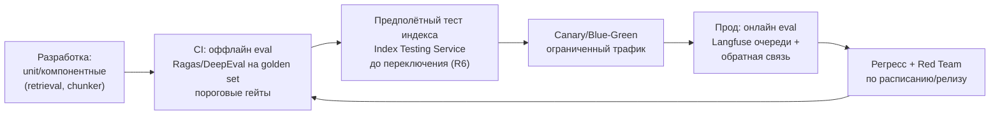

1. **Компонентные** — корректность парсинга/чанкинга, точность retrieval (context precision/recall).
2. **Оффлайн-eval на golden set** — Ragas/DeepEval; гейты в CI (merge блокируется при
   провале порогов). Golden set — эталонные вопрос-ответ + релевантные чанки по НД.
3. **Предполётный тест нового индекса** (R6) — консистентность и корректность информации в RAG
   перед переключением; отчёты — на дашборд; переключение только при прохождении порогов.
4. **Canary/Blue-Green** — часть трафика на candidate-индекс, сравнение метрик.
5. **Онлайн-eval** — выборочная оценка реальных ответов (Langfuse), метрики релевантности (R7),
   информирование пользователя/администратора об ошибках.
6. **Red teaming** — атаки prompt injection, jailbreak, poisoning; метрики precision/recall Guardrails.
7. **Регресс** — при смене модели, промптов, политик Guardrails, версии индекса.

### 2.4. План тестирования (сводно)

| Что | Как | Инструмент | Порог/критерий | Когда |
|-----|-----|-----------|----------------|-------|
| Retrieval | context precision/recall на golden set | Ragas | ≥ 0.80 | CI + предполётно |
| Faithfulness | LLM-as-judge vs контекст | Ragas | ≥ 0.90 | CI + прод (выборка) |
| Answer Relevancy | LLM-as-judge vs вопрос | Ragas | ≥ 0.85 | CI + прод |
| Корректность | сравнение с эталоном | Ragas (answer_correctness) | ≥ 0.80 | CI |
| Галлюцинации | детект неподтверждённых | DeepEval (hallucination) | ≤ 5% | CI + прод |
| Инъекции | наборы атак | DeepEval red team + Guardrails | P≥0.9, R≥0.95 | CI + регулярно |
| PII-маскирование | наборы с ПДн | собственные тесты | 100% детект в тесте | CI |
| Изоляция доступа | попытки cross-tenant | собственные тесты | 0 утечек | CI + регулярно |
| Отчёт-автозаполнение | schema-валидация полей | DeepEval + schema | 0 критичных расхождений | CI + прод |
| Потеря качества | сравнение с baseline | Ragas/Langfuse | регресс ≤ 2% | перед переключением |

Тестовые данные: **golden set** (экспертно размеченный) + синтетические вопросы +
наборы атак + edge-cases (просроченные НД, противоречия, отсутствие ответа).

---

## 3. Observability — дашборд Grafana

### 3.1. Стек и потоки телеметрии

Инструменты: **OpenTelemetry Collector** (сбор) → **Prometheus** (метрики), **Tempo** (трассы),
**Loki** (логи), **Langfuse/LangSmith** (LLM-трассы, промпты, оценки, стоимость) → **Grafana**
(единая визуализация). Инфраструктурный мониторинг (узлы/сеть/GPU) — **отдельный контур** (R11).

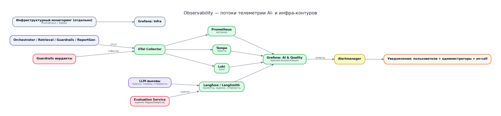

PNG · [SVG](diagrams/observability_flow.svg) · [Graphviz .dot](diagrams/src/observability_flow.dot)

Исходник диаграммы (mermaid)

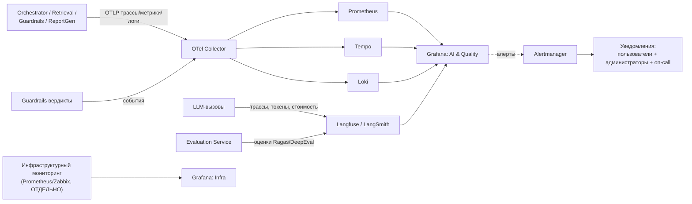

Принцип: **маскирование перед записью** (PII Sanitizer применяется к телеметрии), RBAC на
трассы, ограниченный retention.

### 3.2. Список виджетов дашборда «RAG Quality & AI Ops»

Golden Signals — Latency, Traffic, Errors, Saturation. Плюс AI-метрики — Token usage,
Average Cost per Request.

| # | Виджет | Тип | Метрика/запрос (идея) | Signal | Панель-цель |
|---|--------|-----|------------------------|--------|-------------|
| 1 | **Latency по этапам** | Histogram/Heatmap + p50/p95/p99 | `histogram_quantile(0.95, rag_request_duration_seconds_bucket)` в разрезе `stage=retrieval\|llm\|guard\|total` | Latency | Найти, где задержка |
| 2 | **Traffic (запросы)** | Time series | `sum(rate(rag_requests_total[5m]))` by `type=qa\|report\|ingest` | Traffic | Нагрузка |
| 3 | **Errors / отказы** | Time series + Stat | `sum(rate(rag_requests_total{status="error"}[5m]))`, 5xx, таймауты, отказы LLM | Errors | Доступность |
| 4 | **Saturation** | Gauge/Time series | `llm_queue_depth`, `gpu_kv_cache_usage`, `vdb_query_latency` | Saturation | Ресурсы AI-контура |
| 5 | **Token usage** | Time series + Stacked | `sum(rate(llm_tokens_total[5m]))` by `direction=input\|output`, по тенанту/пользователю | AI | Расход токенов |
| 6 | **Average Cost per Request** | Stat + Time series | `sum(rate(llm_cost_total[5m])) / sum(rate(rag_requests_total[5m]))` | AI | Экономика |
| 7 | **Faithfulness / Answer Relevancy** | Gauge + Trend | `avg(rag_eval_faithfulness)`, `avg(rag_eval_answer_relevancy)` (Langfuse/Ragas) | Quality | Качество ответов |
| 8 | **Hallucination Rate** | Gauge | `avg(rag_hallucination_rate)` | Quality | Достоверность |
| 9 | **Guardrails: блокировки** | Time series + Pie | `sum(rate(guard_decisions_total{verdict="deny"}[5m]))` by `reason=injection\|tool\|pii\|toxicity` | Security | Атаки/шум |
| 10 | **Guardrails precision/recall** | Bar | из red-team прогонов | Security | Эффективность защиты |
| 11 | **PII-маскирование** | Stat + Time series | `sum(rate(pii_masked_total[5m]))`, доля запросов с ПДн | Security | Комплаенс |
| 12 | **Retrieval качество** | Time series | context precision/recall (Ragas, из eval) | Quality | Диагностика RAG |
| 13 | **Feedback пользователей** | Time series + Stat | `rate(user_feedback_total{score="bad"})` | Quality | Ошибки в проде |
| 14 | **Ingestion / переключение индекса** | State timeline | статус проверки индекса, активная версия, результат предполётных тестов | Ops | Безопасные релизы |
| 15 | **Алерты и инциденты** | Table/Logs | активные алерты, доставка уведомлений | Ops | Реакция |

Обязательный минимум **по заданию** — виджеты **1–6** (Golden Signals + Token usage +
Average Cost per Request); виджеты **7–9** демонстрируют «качество ответов, а не только CPU».

### 3.3. Мокап дашборда

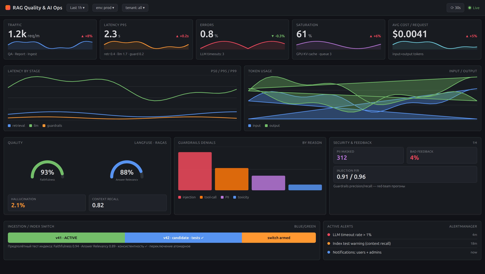

PNG · [HTML-исходник](mockups/grafana_dashboard.html) · панели соответствуют виджетам 1–15 из §3.2

Панели сверху вниз:

- **Row 1 — Golden Signals + AI-метрика**: Traffic (1.2k req/m), Latency p95 (2.3 s, разбивка
  retrieval/llm/guard), Errors (0.8%), Saturation (GPU KV cache 61%), **Avg Cost / Request** ($0.0041).
- **Row 2**: Latency by stage (p50/p95/p99 по этапам) и Token usage (stacked input/output).
- **Row 3**: Quality (гейджи **Faithfulness 93%**, **Answer Relevancy 88%**, Hallucination 2.1%,
  Context recall 0.82), Guardrails denials by reason (injection/tool/PII/toxicity),
  Security & feedback (PII masked 312, Bad feedback 4%, Injection P/R 0.91/0.96).
- **Row 4**: Ingestion / Index switch (blue/green: v41 ACTIVE → v42 candidate tests ✓ → switch
  armed) и Active alerts (Alertmanager, доставка пользователям и администраторам).

### 3.4. Алертинг

- **Пользователи** информируются об ошибке/низком качестве конкретного ответа (inline в UI).
- **Администраторы/on-call** — по Golden Signals и качеству: рост p95 Latency, рост Errors,
  saturation LLM, падение Faithfulness/Answer Relevancy ниже порога, всплеск инъекций, сбой
  предполётного теста индекса.
- Алерты — через Alertmanager → каналы уведомлений; правила изолированы от инфра-мониторинга.

---

## 4. Соответствие критериям оценки задания

| Критерий «Принято» | Как выполнено |
|--------------------|---------------|
| Безопасность: учтены атаки (Prompt Injection) и утечки данных | §1: Input Guard (инъекции/jailbreak), poison-detector (косвенные инъекции), PII Sanitizer, Tool-Call Policy, Output Guard; таблица атак; маппинг OWASP LLM Top 10 |
| Метрики: не «CPU load», а качество ответов модели | §2–3: Faithfulness, Answer Relevancy, Context Precision/Recall, Hallucination Rate — в тестах и на дашборде (виджеты 7–9), плюс Golden Signals как фон |
| Инструментарий: актуальные инструменты | Ragas, DeepEval, OpenTelemetry, Prometheus, Tempo, Loki, Langfuse/LangSmith, Grafana, Alertmanager |
