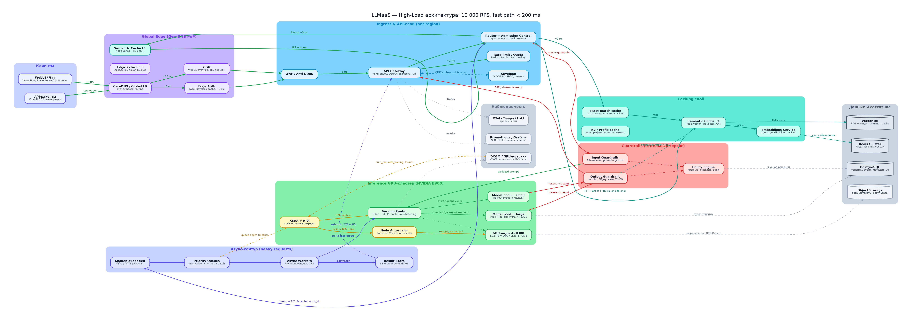
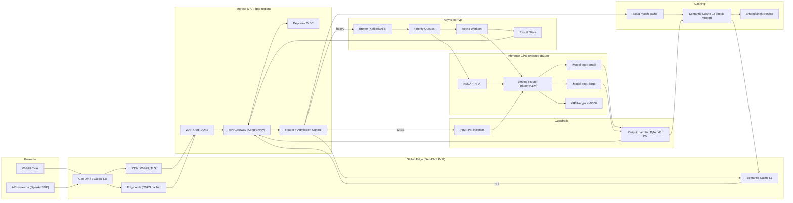

# LLMaaS — Часть 1. Постановка задачи, анализ и принципы решения

**Стартовая страница проекта:** [README.md](README.md)

**Состав отчёта (5 документов):**

1. **Постановка задачи, анализ и принципы решения** ← этот документ
2. [Пропускная способность и масштабирование](02_Пропускная_способность.md)
3. [Guardrails: защита, надёжность, ресурсы и задержка](03_Guardrails_защита.md)
4. [Биллинг запросов](04_Биллинг.md)
5. [Наблюдаемость и аудит](05_Наблюдаемость_и_аудит.md)

---

## 1.1. Источник и цель

Спецификация платформы — файл [`spec.md`](spec.md): AI-сервер на **4× NVIDIA B300**
(Blackwell Ultra). Цель работы — спроектировать сервис **LLMaaS** (LLM-as-a-Service) для
запуска моделей с открытыми весами на этой платформе под целевой нагрузкой.

Сервис должен предоставлять:

- **OpenAI-совместимый API** (`/v1/chat/completions`, `/v1/embeddings`, `/v1/models`);
- **WebUI** для самообслуживания и чата с выбранными моделями;
- отдельный сервис **Guardrails** (защита от утечки ПДн, вредоносного ответа LLM и
  соблюдение требований УК РФ по публикуемой информации);
- аутентификацию пользователей в корпоративном **Keycloak**.

## 1.2. Граничные условия (input)

| Параметр | Значение |
|---|---|
| Пиковая нагрузка | **10 000 RPS** (запросы к API/UI) |
| Требование по латентности | **< 200 мс** |
| Платформа | 4× NVIDIA B300 (288 ГБ HBM3e на карту, **1 152 ГБ** на сервер), NVLink 5, ConnectX-8 (400/800G), BlueField-3 DPU |
| CPU / RAM | 2× Xeon 6 / EPYC 9005 (96–128 ядер), 1.5–2 ТБ DDR5 |
| Storage | RAID1 NVMe (ОС), 4× 7.68 ТБ NVMe Gen5 (веса/датасеты) |
| Питание | 4–6× БП 2700–3200 Вт (N+N/N+1), **6.5–8.0 кВт** на сервер |
| Сеть | East-West: ConnectX-8 InfiniBand NDR/XDR / RoCEv2; North-South: BlueField-3 |
| ПО | Ubuntu/RHEL, NVIDIA AI Enterprise, CUDA, NCCL, **Triton** |

Платформа задаёт **единицу масштабирования** — один сервер с 4 GPU и 1.15 ТБ VRAM.

## 1.3. Функциональные требования

| № | Требование |
|---|---|
| F1 | OpenAI-совместимый API (chat, completions, embeddings, models) |
| F2 | WebUI: выбор модели, чат, история, ключи/лимиты |
| F3 | Стриминг ответов (SSE) |
| F4 | Guardrails: input- и output-проверки, LLM-as-a-Judge, мультимодальность |
| F5 | Аутентификация/авторизация через Keycloak (OIDC/SSO, RBAC, тенанты) |
| F6 | Мультитенантность: изоляция, квоты, лимиты |
| F7 | Учёт использования и биллинг (токены, модальности, приоритеты) |
| F8 | Наблюдаемость и аудит действий пользователей и решений guardrails |

## 1.4. Нефункциональные требования и целевые SLO

| SLO | Цель |
|---|---|
| Латентность fast path (кэш-попадание) | **p99 < 200 мс** |
| TTFT (время до первого токена) | p95 < 300–600 мс |
| Доступность API | 99.9% |
| Cache hit-rate (semantic) | > 45% |
| Error rate (5xx) | < 0.1% |
| Guardrails: дополнительная задержка | вход ~20–45 мс p95 (скрыта prefill'ом), judge на 5–15% ответов |
| Резидентность | данные/ПДн не покидают регион (152-ФЗ / GDPR) |

## 1.5. Анализ: ключевое противоречие

Требования «10 000 RPS» и «Latency < 200 мс» **физически несовместимы с полной генерацией
текста большими моделями**:

- одна генерация ответа на 70B-классе — это **секунды**, а не 200 мс;
- полная генерация 10 000 RPS потребовала бы **сотен GPU-серверов и мегаватт** энергии —
  при 6.5–8 кВт на сервер это экономически нереализуемо на on-prem.

**Вывод анализа.** Требование «< 200 мс» относится не к генерации, а к **оркестрации запроса**:
edge-слой, аутентификация, rate-limit, **кэш-попадание**. Генерация нормируется отдельно
(TTFT + стриминг), а тяжёлые запросы уводятся в асинхронный контур. Это и есть основа решения.

**Что из этого следует количественно:**

- если semantic cache гасит ~50% повторов, до GPU доходит ~5 000 RPS — уже посильная задача;
- остаток распределяется по пулам моделей (small/large) и очередям приоритетов;
- пик закрывается **эластичностью** (KEDA + node autoscaler), а не «железом под пик».

## 1.6. Принципы решения

1. **Two-tier latency design.** Путь запроса делится на **fast path** (без генерации, бюджет
   < 200 мс) и **slow path** (генерация: стриминг или async-очередь). Основной объём RPS
   гасится кэшем и edge-слоем, а не GPU.
2. **Cache-first.** Трёхуровневый кэш (CDN + L1 edge + L2 semantic) — главный рычаг
   производительности и стоимости.
3. **Tiered models.** Дешёвые запросы (route, короткий ответ, guard-модели) обслуживает
   small-пул; large-пул (70B+/MoE) — только сложные запросы.
4. **Async для тяжёлого.** Длинный контекст, RAG, агенты, batch → очередь (`202 Accepted` +
   `job_id`), а не попытка уложиться в онлайн-бюджет.
5. **Backpressure вместо деградации.** Лучше честный `429/503` с `Retry-After`, чем рост
   латентности и каскадные отказы.
6. **Guardrails на критическом пути, но «ноль» вносимой задержки.** Параллельные проверки,
   ранний старт инференса, early-abort (детали — в части 3).
7. **Edge и Geo-DNS.** Латентность и резидентность данных для распределённых пользователей.
8. **Наблюдаемость и аудит по умолчанию.** Каждое решение наблюдаемо; критические решения
   (guardrails, доступ, изменения) — в неизменяемом аудите.

## 1.7. Общая схема и слои

PNG · [SVG](diagrams/01_highload_overview.svg) · [Graphviz .dot](diagrams/src/01_highload_overview.dot)

Исходник диаграммы (mermaid)

**Слои и их роль:**

| Слой | Компоненты | Задача |
|---|---|---|
| Edge | Geo-DNS, CDN, Edge Auth, Edge rate-limit, L1 cache | Терминация TLS, отдача статики и «горячего» кэша рядом с пользователем |
| Ingress/API | WAF, API Gateway (Kong/Envoy), Keycloak, Rate-limit, Admission Control | Единая OpenAI-совместимая точка входа, авторизация, защита, классификация запроса |
| Caching | Exact-match, Semantic Cache L2, Embeddings Service, KV/prefix cache | Резкое снижение числа вызовов GPU |
| Guardrails | Input (PII/injection), Output (harmful/ПДн/УК РФ), Policy Engine, LLM-as-a-Judge | Отдельный сервис безопасности LLM |
| GPU | Serving Router (Triton+vLLM), пулы моделей, GPU-ноды 4×B300, KEDA | Генерация и эмбеддинги |
| Async | Broker, Priority Queues, Workers, Result Store | Разгрузка тяжёлых/долгих запросов |
| Данные | Redis Cluster, Vector DB, PostgreSQL, Object Storage | Состояние, кэш-индекс, веса, аудит |
| Наблюдаемость/Биллинг | Prometheus/Grafana/OTel, Audit Service, Usage-пайплайн | SLO, инциденты, учёт и биллинг |

## 1.8. Границы и допущения

- Рассматривается **on-prem** кластер из серверов по `spec.md`; единица масштабирования —
  1 сервер (4× B300).
- Guardrails и биллинг — **собственные сервисы** платформы, а не внешние SaaS.
- Числовые оценки (hit-rate, throughput, число серверов) — **модельные допущения**,
  уточняются нагрузочным тестом; они приведены, чтобы показать порядок величин и точки
  чувствительности.
- «10 000 RPS» трактуется как суммарный поток API-запросов, включая кэш-попадания,
  инициализации стримов и async-постановки задач.
