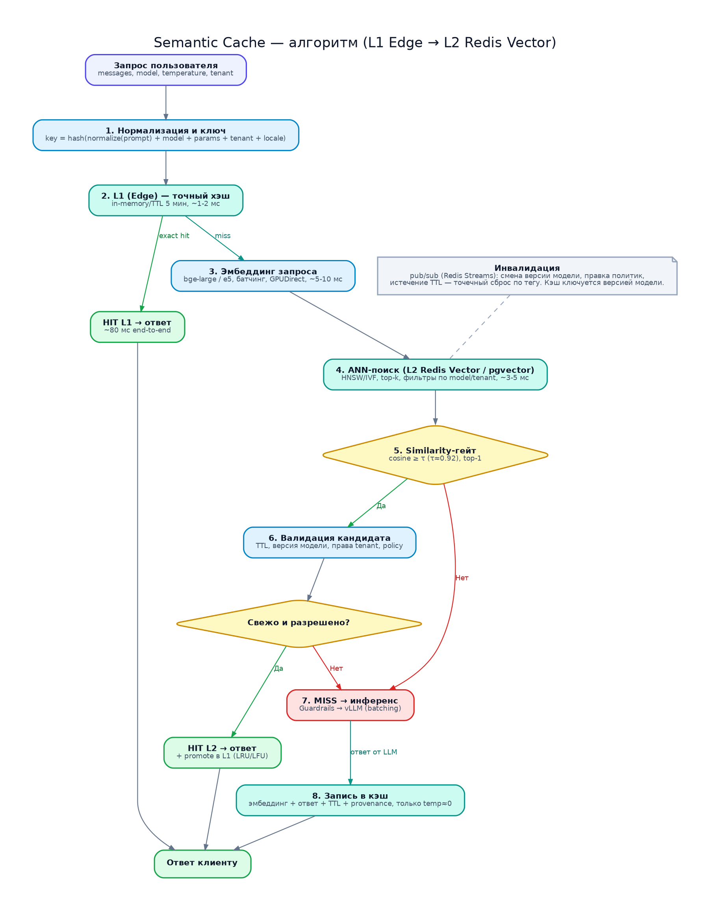
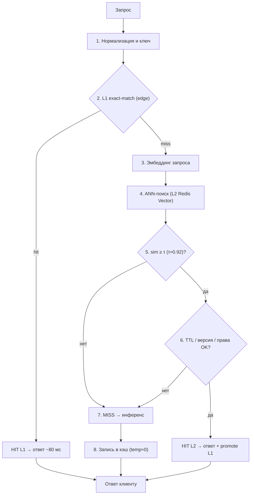
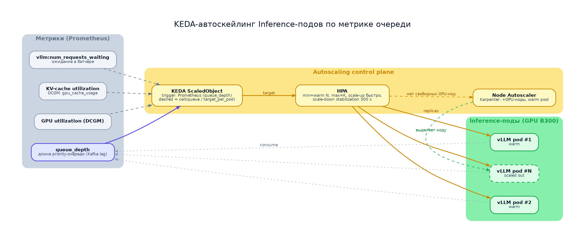
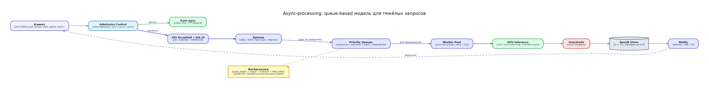
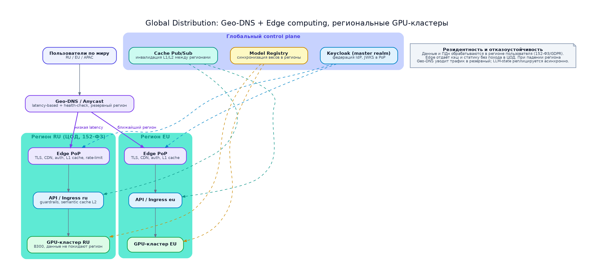

# LLMaaS — Часть 2. Пропускная способность и масштабирование

**Стартовая страница проекта:** [README.md](README.md)

**Состав отчёта (5 документов):**

1. [Постановка задачи, анализ и принципы решения](01_Постановка_задачи.md)
2. **Пропускная способность и масштабирование** ← этот документ
3. [Guardrails: защита, надёжность, ресурсы и задержка](03_Guardrails_защита.md)
4. [Биллинг запросов](04_Биллинг.md)
5. [Наблюдаемость и аудит](05_Наблюдаемость_и_аудит.md)

Документ отвечает на вопрос: **как обработать 10 000 RPS при SLO < 200 мс** и сколько для
этого нужно оборудования. Разделы: кэширование, автоскейлинг, async, geo-распределение,
sizing, бюджет латентности, сводка паттернов.

---

## 2.1. Как 10 000 RPS превращаются в посильную нагрузку

| Шаг | Эффект | Остаток RPS |
|---|---:|---:|
| Исходный поток | — | 10 000 |
| CDN отдаёт WebUI/статику | не доходит до origin | ~9 000 |
| L1 exact-match (edge) | быстрые повторы | ~8 000 |
| **L2 semantic cache (hit-rate 50%)** | семантические дубли | **~5 000** |
| Tiered routing: small-пул | route/короткие ответы | ~3 000 (large) |
| **GPU-нагрузка** | small ~2 000 + large ~3 000 | **5 000** |

Ключ — **кэш**: он превращает «сотни GPU-серверов» в «десятки».

## 2.2. Caching Strategy

Применяется **трёхуровневая схема** плюс два вспомогательных кэша.

### 2.2.1. Уровни кэширования

| Где | Что кэшируется | Назначение | Эффект |
|---|---|---|---|
| **CDN (edge)** | WebUI (SPA), статика, справочники моделей, OpenAPI | Не доходит до origin | Снимает десятки % RPS |
| **API Gateway (L1, edge)** | Точный хэш запроса (exact-match), JWKS Keycloak, rate-limit | Быстрые повторы | Отдача за ~2–5 мс |
| **Redis (Semantic Cache L2)** | `эмбеддинг запроса → ответ LLM` в векторном индексе | Семантические дубли | **−40–60% вызовов GPU** |
| **Redis (эмбеддинги)** | Кэш векторов по тексту | Ускоряет L2-поиск | −5–10 мс на lookup |
| **GPU (KV / prefix cache)** | KV-кэш префиксов, RAG-контекста (PagedAttention) | Повторные длинные префиксы | Ниже TTFT, выше throughput |

### 2.2.2. Алгоритм Semantic Cache

Кэш отдаёт ответ и на **семантически близкий** запрос (перефразировки, опечатки, синонимы) —
именно такие повторы дают основной hit-rate.



<sub>PNG · [SVG](diagrams/02_semantic_cache.svg) · [Graphviz .dot](diagrams/src/02_semantic_cache.dot)</sub>

<details><summary>Исходник диаграммы (mermaid)</summary>



</details>

**Шаги:**

1. **Нормализация и ключ.** `key = hash(prompt + model + params + tenant + locale)`. Версия
   модели, параметры и тенант **обязательно** в ключе — иначе утечка ответа между арендаторами.
2. **L1 (edge) — exact-match.** Точный хэш в памяти edge-узла (TTL ~5 мин) → ответ за ~2–5 мс.
3. **Эмбеддинг запроса.** Embeddings Service (`bge-large`/`e5`), батчинг, ~5–10 мс; вектор тоже
   кэшируется по хэшу текста.
4. **ANN-поиск в L2.** Redis Vector / pgvector (HNSW/IVF), top-k с фильтрами `model`, `tenant`,
   TTL. ~3–5 мс.
5. **Similarity-гейт.** `max cosine ≥ τ` (τ ≈ 0.92) → кандидат считается попаданием.
6. **Валидация кандидата.** TTL, версия модели, права тенанта, политики guardrails.
7. **Попадание.** Ответ отдаётся и **продвигается в L1** (LRU/LFU).
8. **Промах.** Инференс (Guardrails → vLLM); ответ **записывается** с `эмбеддинг + TTL +
   provenance`. Кэшируются только детерминированные ответы (`temperature ≈ 0`).

**Порог τ — компромисс:** выше τ → меньше ложных попаданий, но ниже hit-rate; ниже τ → растёт
hit-rate, но риск нерелевантного ответа. τ подбирается по кривой hit-rate/precision и
контролируется метрикой `cache_false_hit_rate`.

**Инвалидация.** Pub/sub (Redis Streams): смена версии модели, правка политик, истечение TTL →
точечный сброс по тегу. Кэш привязан к версии модели — при деплое ключи `model_version` меняются.

**Защита от «стада».** Single-flight / request coalescing: одновременные одинаковые запросы
объединяются в один вызов LLM. Плюс идемпотентность для async-задач.

> **Эффект кэша:** semantic hit-rate 45–60% → из 10 000 RPS до GPU доходит **~4 000–5 500 RPS**.

---

## 2.3. Scaling — KEDA-автоскейлинг Inference-подов по метрике очереди

Масштабирование GPU-подов управляется **длиной очереди**, а не CPU/GPU utilization
(у LLM-инференса последняя «лжёт»: GPU может быть занят, но не успевать).



<sub>PNG · [SVG](diagrams/03_keda_autoscaling.svg) · [Graphviz .dot](diagrams/src/03_keda_autoscaling.dot)</sub>

**Метрики-триггеры (Prometheus):**

- `queue_depth` — длина priority-очереди брокера (Kafka lag) — **основной**;
- `vllm:num_requests_waiting` — запросы, ждущие батчера;
- `gpu_cache_usage_perc` (DCGM) — заполнение KV-кэша;
- `gpu_utilization` (DCGM) — вспомогательная.

**Правило:** KEDA ScaledObject с Prometheus-trigger:

```
desired_replicas = ceil(queue_depth / target_per_pod)
```

HPA задаёт `min` (warm-пул) и `max`, **быстрый scale-up** и **медленный scale-down**
(стабилизация ≈ 300 с), чтобы не «дёргать» дорогие GPU.

**Двухуровневое масштабирование** (важно для GPU): поды масштабируются KEDA/HPA, но им нужны
**GPU-ноды** → добавлен **Node Autoscaler** (Karpenter/Cluster Autoscaler):

- **Warm pool** — минимум нод прогреты с загруженными весами (загрузка 70B в VRAM — минуты);
- при исчерпании свободных GPU-нод — подъём новых;
- веса подтягиваются по RDMA/GPUDirect из Object Storage.

**Почему не scale-to-zero:** холодный старт LLM — десятки секунд, что нарушает SLO.
Компромисс: warm pool + агрессивный scale-up.

---

## 2.4. Async Processing — queue-based модель для тяжёлых запросов

Длинный контекст, RAG, агентные цепочки, batch нельзя обслужить в онлайн-бюджете — их переводят
в **асинхронную очередь**.



<sub>PNG · [SVG](diagrams/04_async_processing.svg) · [Graphviz .dot](diagrams/src/04_async_processing.dot)</sub>

**Поток:**

1. **Admission Control** классифицирует запрос: лёгкий → sync (stream), тяжёлый → async;
   применяются квоты тенанта.
2. Клиент получает **`202 Accepted` + `job_id`**; результат — через poll / webhook / WebSocket.
3. Задача публикуется в **брокер** (Kafka / NATS JetStream) с партиционированием.
4. **Priority Queues:** `interactive > standard > batch`; внутри — weighted-fair по тенантам.
5. **Worker Pool** (consumer groups) вычитывает задачи с **backpressure**; ретраи + DLQ.
6. Генерация → **Guardrails (output)** → **Result Store** (S3 + метаданные в PG, TTL).
7. **Notify** — webhook / SSE / WS.

**Backpressure / load shedding:** при `queue_depth > порога` шлюз отвечает `429/503` с
`Retry-After`. Класс `interactive` не вытесняется `batch`. Именно `queue_depth` — триггер KEDA.

| Критерий | Sync (stream) | Async (queue) |
|---|---|---|
| Тип запроса | чат, короткие ответы | RAG, длинный контекст, batch, агенты |
| Ответ | SSE-поток, SLO на TTFT | `202` + job_id + webhook |
| Латентность | секунды (стрим) | минуты, ретраи |
| Приоритет | interactive | standard / batch |

---

## 2.5. Global Distribution (Geo-DNS + Edge computing)



<sub>PNG · [SVG](diagrams/05_global_distribution.svg) · [Graphviz .dot](diagrams/src/05_global_distribution.dot)</sub>

- **Geo-DNS / Anycast** — latency-based routing в ближайший PoP; health-check уводит трафик из
  упавшего региона.
- **Edge computing (PoP):** TLS-терминация, CDN, локальная проверка JWT (JWKS-кэш), локальный
  rate-limit, **L1 semantic cache** — «горячие» ответы без похода в ЦОД.
- **Региональные GPU-кластеры:** инференс и guardrails в регионе пользователя; **данные и ПДн не
  покидают регион** (152-ФЗ / GDPR); guardrails регионально-специфичны.
- **Глобальный control plane:** Keycloak (master realm, федерация IdP), Model Registry
  (синхронизация весов), Cache Pub/Sub (инвалидация L1/L2).
- **Отказоустойчивость:** при падении региона Geo-DNS уводит трафик в резервный; состояние
  реплицируется асинхронно; веса моделей есть в каждом регионе.

---

## 2.6. Sizing — сколько нужно GPU-серверов

### 2.6.1. Допущения о профиле нагрузки

| № | Допущение | Значение |
|---|---|---|
| 1 | Hit-rate semantic cache | 50% (диапазон 45–60%) |
| 2 | Средняя длина ответа | ~250 выходных токенов |
| 3 | Доля лёгких запросов среди дошедших до GPU | ~15% |

| Категория | Доля | Кто обслуживает | Доходит до GPU |
|---|---|---|---|
| Семантические дубли | ~50% | кэш (L1/L2) | **нет** |
| Лёгкие: route, guard-модели, короткий ответ | ~8% | small-пул (8B) | да |
| Тяжёлые: длинный контекст, RAG, генерация | ~42% | large-пул (70B+/MoE) | да |

### 2.6.2. Нагрузка на GPU после кэша

```
Всего                        10 000 RPS
× (1 − cache 50%)          =  5 000 RPS   → доходят до инференса
     ├─ small-пул           ≈  2 000 RPS
     └─ large-пул           ≈  3 000 RPS
```

### 2.6.3. Сколько даёт один сервер 4×B300

Базис: 4× B300 (1 152 ГБ VRAM), vLLM, continuous batching + prefix cache, ~250 токенов на ответ.

| Пул | Модель | Throughput | Запросов/с на сервер | Нужно серверов |
|---|---|---|---|---|
| small | 8B | 40 000–80 000 ток/с | ~250–400 | 2 000 / 400 ≈ **5** |
| large | 70B (INT4/FP8) | 8 000–15 000 ток/с | ~40–60 | 3 000 / 60 ≈ **50** |

Формула: `серверов = RPS_пула ÷ (throughput_ток/с ÷ токенов_на_ответ)`.

### 2.6.4. Итог

> **~55–75 GPU-серверов** (large-пул доминирует) плюс small-пул, guardrails и embeddings;
> с резервом на warm-пул и отказоустойчивость — до ~80. Это ~450–600 кВт и значительные
> CapEx/OpEx.

**Что снижает число серверов:**

- рост hit-rate кэша: 60% вместо 50% → примерно −20% серверов large-пула;
- **MoE-модели** — больший throughput на тот же VRAM;
- tiered routing: больше запросов на small-пул;
- speculative decoding и prefix-cache reuse.

**Как уточнять sizing:** нагрузочный тест (k6/Locust) с реалистичным распределением промптов;
τ и TTL cache — по кривой hit-rate/precision; `target_per_pod` для KEDA — по замеру throughput
пода; порог admission control — по SLO хвостовой латентности.

---

## 2.7. Бюджет латентности fast path (< 200 мс)

| Шаг | Бюджет |
|---|---|
| Geo-DNS + TLS-терминация на edge (CDN) | ~10 мс |
| WAF / Anti-DDoS | ~5 мс |
| API Gateway (маршрутизация + сериализация) | ~3 мс |
| Аутентификация (локальная валидация JWT по JWKS-кэшу) | ~3 мс |
| Rate-limit (Redis token bucket на edge) | ~2 мс |
| Admission Control | ~1 мс |
| L1 exact-match lookup | ~2 мс |
| L2 semantic: эмбеддинг (~6 мс) + ANN-поиск (~4 мс) | **~10 мс** |
| Проверка квоты биллинга (Redis) | ~1 мс |
| Отдача ответа клиенту | ~5 мс |
| **Итого (p50)** | **~40–60 мс** |

**Как читать бюджет:**

- **Fast path (кэш-попадание):** укладываемся в 200 мс с большим запасом (~40–60 мс p50, что
  даёт место для p99 при корректном sizing edge-слоя).
- **Промах кэша:** «< 200 мс» относится к ACK / первому байту; для генерации нормируется
  отдельно — **TTFT p95 ~300–600 мс** и полное время ответа.
- **Тяжёлые запросы:** уходят в async-контур (§2.4) с SLO на постановку задачи, а не на генерацию.

### 2.7.1. Keycloak при 10 000 RPS

- **Кластер Keycloak** за балансировщиком, stateless-токены (JWT).
- API Gateway валидирует JWT **локально** по JWKS-ключу (кэш, ротация по `kid`) — без похода в
  Keycloak на каждый запрос. Introspection — только где нужен отзыв, и **кэшируется в Redis**.
- Локальный edge-rate-limit защищает и Keycloak, и backend от всплесков.

---

## 2.8. Сводка паттернов оптимизации

| Паттерн | Где | Эффект |
|---|---|---|
| Tiered caching (CDN + L1 + L2) | Edge / Gateway / Redis | −40–60% вызовов GPU, fast path ~40 мс |
| Semantic caching (ANN + τ-гейт) | Redis Vector | Покрытие перефразировок, основной hit-rate |
| Cache-aside + promotion L2→L1 | Cache layer | Быстрые повторы за единицы мс |
| Single-flight / request coalescing | Gateway | Убирает «стадо» одинаковых запросов |
| Continuous batching + PagedAttention | vLLM | Кратный рост throughput GPU |
| Prefix / KV-cache reuse | vLLM | Ниже TTFT, выше concurrency |
| Tiered model routing (small→large) | Serving Router | Дешёвые запросы не занимают large-пул |
| Queue-based load leveling | Async-контур | Разгрузка пиков |
| Priority queues + weighted-fair | Broker | SLA интерактива, справедливость тенантов |
| Backpressure + admission control | Gateway | Load shedding вместо роста латентности |
| Queue-driven autoscaling (KEDA) | Inference pods | Масштабирование по реальному спросу |
| Warm pool + node autoscaling | GPU-ноды | Нет cold-start, нет простоя GPU |
| Edge computing + Geo-DNS | Global edge | Латентность и резидентность данных |
| Idempotency keys + DLQ | Async | Безопасные ретраи, устойчивость |
