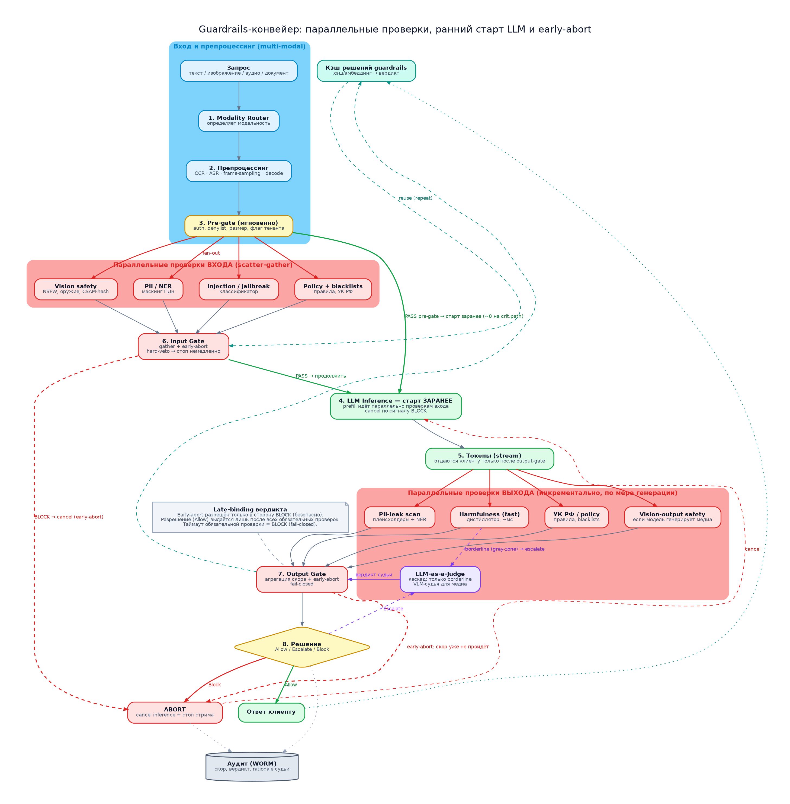
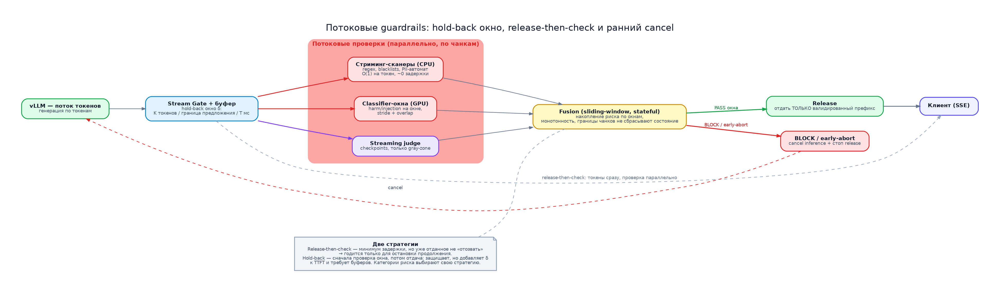
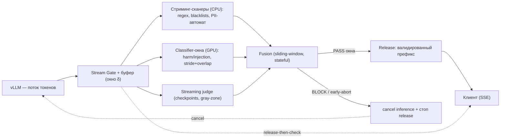

# LLMaaS — Часть 3. Guardrails: защита, надёжность, ресурсы и задержка

**Состав отчёта (5 документов):**

1. [Постановка задачи, анализ и принципы решения](01_Постановка_задачи.md)
2. [Пропускная способность и масштабирование](02_Пропускная_способность.md)
3. **Guardrails: защита, надёжность, ресурсы и задержка** ← этот документ
4. [Биллинг запросов](04_Биллинг.md)
5. [Наблюдаемость и аудит](05_Наблюдаемость_и_аудит.md)

---

## 3.1. Назначение и требования

Guardrails — **отдельный сервис** (свой цикл релизов, свой GPU-пул, свои SLO), решающий три
задачи:

1. **Защита ПДн** — не допустить утечки персональных данных ни в LLM, ни из неё.
2. **Защита от вредоносного ответа** — токсичность, опасный контент, обход инструкций.
3. **Соблюдение требований УК РФ** по публикуемой информации (policy-движок + классификатор
   + LLM-as-a-Judge).

Сервис подключается к Serving Router как **обязательный контур** на пути запроса и вызывается
**дважды**: до генерации (**input**) и на выходе (**output**).

## 3.2. Конвейер guardrails

```mermaid
flowchart TB
    REQ["Запрос (multi-modal)"] --> R["1. Modality Router"]
    R --> P["2. Препроцессинг: OCR / ASR / frames"]
    P --> PRE["3. Pre-gate (мгновенно)"]
    PRE -->|"PASS"| INF["4. LLM Inference — старт ЗАРАНЕЕ"]
    PRE -->|"fan-out"| C1["PII / NER"]
    PRE --> C2["Injection / Jailbreak"]
    PRE --> C3["Policy + blacklists (УК РФ)"]
    PRE --> C4["Vision safety (NSFW/CSAM-hash)"]
    C1 --> GIN["6. Input Gate + early-abort"]
    C2 --> GIN
    C3 --> GIN
    C4 --> GIN
    GIN -->|"PASS → продолжить"| INF
    GIN -.->|"BLOCK → cancel"| AB["ABORT: cancel + стоп"]
    INF --> ST["5. Токены (stream)"]
    ST --> O1["PII-leak scan"]
    ST --> O2["Harmfulness (fast)"]
    ST --> O3["УК РФ / policy"]
    ST --> O4["Vision-output safety"]
    O2 -.->|"borderline"| J["LLM-as-a-Judge (каскад/VLM)"]
    O1 --> GOUT["7. Output Gate + early-abort"]
    O2 --> GOUT
    O3 --> GOUT
    O4 --> GOUT
    J --> GOUT
    GOUT --> D{"8. Решение"}
    D -->|"Allow"| OUT["Ответ клиенту"]
    D -->|"Block"| AB
    D -.->|"Escalate"| J
    GOUT -.->|"скор уже не пройдёт"| AB
    AB -.->|"cancel"| INF
    OUT --> AU["Аудит (WORM)"]
    AB --> AU
    GOUT --> CACHE["Кэш решений guardrails"]
    CACHE -.->|"reuse"| GIN
```



<sub>PNG · [SVG](diagrams/06_guardrails_pipeline.svg) · [Graphviz .dot](diagrams/src/06_guardrails_pipeline.dot)</sub>

<details><summary>Исходник диаграммы (mermaid)</summary>



</details>

## 3.3. Что проверяем

| Фаза | Проверка | Тип | Что ловит |
|---|---|---|---|
| Input | PII / NER | ML + regex | ПДн в промпте (маскируются до отправки в LLM) |
| Input | Prompt injection / jailbreak | ML | «ignore previous», утечка системного промпта |
| Input | Policy + blacklists | rules | прямой запрет по правилам / УК РФ |
| Input | Vision safety | ML + hash | NSFW, оружие/насилие, **CSAM** в изображениях |
| Output | PII-leak scan | regex + ML | восстановленные плейсхолдеры, повторная генерация ПДн |
| Output | Harmfulness (fast) | ML (дистиллятор) | вредоносный / опасный контент |
| Output | УК РФ / policy | rules + ML | публикуемая информация, недопустимая по закону |
| Output | Vision-output safety | ML | небезопасная генерация медиа |
| Output | **LLM-as-a-Judge** | LLM / VLM | смысловые нарушения, юридические нюансы, соответствие политике |

## 3.4. Параллелизм, ранний старт LLM и early-abort

Три принципа убирают guardrails с критического пути:

1. **Scatter–gather (параллельно).** Все проверки фазы запускаются одновременно; время фазы
   ≈ `max(проверок)`, а не их сумма.
2. **Оптимистичный ранний старт LLM.** Как только пройден **pre-gate** (auth, denylist, размер,
   флаг тенанта), инференс **запускается сразу** — параллельно классификаторам входа. Prefill
   идёт «под» входными проверками, поэтому для обычного проходящего запроса guardrails **не
   добавляют задержки**. Если вход позже отклонён — инференс **отменяется** (`cancel`).
3. **Fast-fail / early-abort.** Каждая проверка сразу отдаёт вклад в агрегированный риск.
   Если вердикт **уже не может** стать «пропустить» — конвейер останавливается, инференс
   отменяется, клиент получает отказ; оставшиеся проверки не ждём.

**Формально.** Проверка `i` возвращает `veto_i` (жёсткий запрет) и скор `s_i ∈ [0,1]`
(1 — безопасно). Агрегат: `Risk = Σ wᵢ · (1 − sᵢ)`, решение:

- любой `veto_i = true` (правило / blacklist / CSAM-hash) → **BLOCK немедленно** (hard-veto);
- `Risk > T_block` → **BLOCK**; `T_gray < Risk ≤ T_block` → **ESCALATE** (в LLM-as-a-Judge);
  `Risk ≤ T_gray` → **ALLOW**;
- **early-abort** — когда `Risk > T_block` набран *до* прихода остальных проверок: останавливаем
  цикл и отменяем генерацию.

**Late-binding (ключ к безопасности):** early-abort разрешён **только в сторону BLOCK**. Вердикт
**ALLOW** выдаётся лишь после того, как отработали **все обязательные** проверки; таймаут
обязательной проверки трактуется как BLOCK (**fail-closed**). Так «быстрый отказ» никогда не
превращается в «быстрый пропуск».

На выходе алгоритм работает **инкрементально**: пока LLM генерирует токены, проверки оценивают
уже сформированный фрагмент, а буфер освобождается клиенту порциями, прошедшими output-gate.

## 3.5. LLM-as-a-Judge

Судья применяется там, где бинарный классификатор ненадёжен: тон вредоносности, юридические
нюансы УК РФ, соответствие сложной политике, качество ответа. Чтобы не платить его цену на
каждом запросе, используется **каскад**:

```
быстрые проверки (rules + дистиллятор)
        ├─ Risk ≤ T_gray          (уверенно безопасно)  → ALLOW, judge НЕ запускается
        ├─ Risk > T_block         (уверенно нарушение)   → BLOCK
        └─ T_gray < Risk ≤ T_block (gray-zone)           → LLM-as-a-Judge (5–15% запросов)
```

- **Дистиллированный судья** на small-модели для текста и **VLM-судья** для медиа, в отдельном
  GPU-пуле с **высоким приоритетом** и батчингом.
- **Стриминговый режим:** судья оценивает фрагмент ответа, а не только готовый текст.
- **Строгий контракт вердикта:** JSON `{verdict, score, category, policy_id, judge_version,
  rationale}`; `rationale` пишется в аудит.
- **Версионирование и калибровка:** `judge_version` и промпт пиннятся; пороги `T_gray/T_block`
  калибруются на golden-set; периодическая валидация человеком (human-in-the-loop).
- **Двойное судейство** для критичных категорий (УК РФ): две модели; для ALLOW нужно согласие,
  расхождение → BLOCK + очередь ручной модерации.
- **Кэш вердиктов** судьи по хэшу/эмбеддингу ответа — повторы оцениваются один раз.

## 3.6. Мультимодальные запросы

Принцип: **сначала извлечь текст/сигналы, затем параллельно запустить модально-специфичные
детекторы**. Общие требования (ПДн, УК РФ, harmfulness) применяются к извлечённому тексту.

| Модальность | Препроцессинг | Проверки входа | Проверки выхода |
|---|---|---|---|
| Текст | нормализация, токенизация | PII/NER, injection, policy | PII-leak, harm, УК РФ, judge |
| Изображение | decode, resize, EXIF-strip | vision-safety (NSFW/оружие), OCR → текст, лица/ПДн, **CSAM-hash** | vision-output safety, judge-VLM |
| Аудио | ASR (Whisper) → текст | текст-проверки по транскрипту, голос-ПДн | проверки speech/TTS-вывода |
| Документ / PDF | парсинг, OCR, метаданные | PII/NER, policy, скрытые макросы | утечка метаданных, watermark |
| Видео | frame-sampling + аудио-трек | кадры (vision) + транскрипт (текст) | safety по кадрам и тексту |

- **Reuse извлечённого:** текст из OCR/ASR и эмбеддинги переиспользуются и в guardrails, и в
  inference / KV-кэше.
- **Медиа- и текстовые детекторы идут параллельно**; критический путь — самый долгий из них.
- **CSAM** — только hash-matching по спискам (PhotoDNA-подобные), **жёсткий `veto`**; в LLM не
  попадает, инцидент → немедленный аудит-алерт.
- Тяжёлый препроцессинг (**ASR, видео**) выводит запрос из онлайн-бюджета → такие запросы идут
  в async-контур (часть 2).

## 3.7. Надёжность guardrails как единой точки отказа (SPOF)

Guardrails стоят **на пути каждого генерируемого запроса** — это делает их потенциальной **единой
точкой отказа (SPOF)** сразу в двух смыслах:

- **по доступности:** если сервис недоступен, то либо блокируется всё (fail-closed → падение
  доступности LLMaaS), либо трафик идёт без проверок (риск ИБ/закона);
- **по безопасности:** ошибка/регрессия в guardrails (или в политиках) деградирует защиту
  незаметно для остальной системы.

**Целевое требование к надёжности.** Доступность guardrails должна быть **выше** доступности
API: чтобы не «уронить» SLO 99.9%, сам сервис проектируется на **≥ 99.95%** (нет ни одной
нерезервируемой зависимости на критическом пути).

**Меры против SPOF:**

| № | Мера | Что даёт |
|---|---|---|
| 1 | **Stateless + горизонтальные реплики в ≥ 2 зонах** | Нет единственного экземпляра; отказ зоны не роняет сервис |
| 2 | **Bulkhead-изоляция** (отдельный GPU-пул, namespace, квоты) | Отказ guardrails не роняет инференс, и наоборот |
| 3 | **Tiered degradation (graceful)** | При недоступности LLM-judge падаем на rules+дистиллятор, а не отключаем защиту; при отказе GPU-слоя остаётся CPU-слой правил/blacklists («режим пониженной защиты» + алерт + аудит) |
| 4 | **Fail-closed по умолчанию** для обязательных output-проверок | Безопасность важнее доступности: сбой/таймаут ⇒ блок |
| 5 | **Timeouts + circuit breaker + hedging** | Не ждём зависший слой; быстрый переход на резервный пул |
| 6 | **Warm pool guard-моделей** | Нет cold-start; предсказуемая латентность |
| 7 | **Реплицированные зависимости** | Кэш вердиктов (Redis Cluster), policy-store, rate cards — без SPOF |
| 8 | **Версионирование политик + безопасные дефолты** | Плохой релиз политики откатывается; правила fail-safe |
| 9 | **Controlled kill-switch** | Аварийный режим для критичных бизнес-сценариев — только по решению владельца риска, с полным аудитом и постфактум-пересканированием |
| 10 | **Наблюдаемость решений guardrails** | Метрики block/escalate/allow, latency, ошибки; алерты на регрессии (рост false-negative и false-positive) |

**Ключевой компромисс.** Fail-closed защищает безопасность, но связывает доступность LLMaaS с
доступностью guardrails. Поэтому по умолчанию — fail-closed для **обязательных** проверок и
**деградация** (не отказ) для **дополнительных** слоёв. Отключение проверок (kill-switch) —
исключительный, аудируемый сценарий, а не штатный режим.

## 3.8. Оценка требуемых ресурсов

Оценка для пика 10 000 RPS и допущений части 2 (до GPU/проверок доходит ~5 000 RPS; cache-hit
guardrails не проходят повторно).

| Компонент | Нагрузка | Модель | Throughput (сервер 4×B300) | Нужно серверов |
|---|---|---|---|---|
| Classifier-пул (PII / injection / harmfulness) | ~10 000 проверок/с (input + output) | дистилляторы 0.1–1B | ~15 000–30 000 проверок/с | **1–2** (+N+1) |
| **LLM-as-a-Judge** | 250–750 зап/с (5–15% от 5 000) | 7–8B (текст) / VLM | ~150–400 зап/с | **2–3** (+N+1) |
| Vision safety (NSFW / CSAM-hash) | доля медиа, обычно < 5% | CLIP-подобный + hash (CPU) | — | **1** (+N+1) или shared |
| Rules / policy (regex, blacklists) | 100% запросов | CPU | — | CPU-пул (8–16 vCPU × N) |
| Embeddings (общие с cache) | ~5 000 | `bge-large` | — | shared с кэшем |

> **Итого guardrails: ~4–6 GPU-серверов (16–24× B300)** с резервированием N+1 по каждому пулу,
> плюс CPU-пул для правил. Это ~15–25% от GPU-парка инференса — цена обязательной защиты.
> Точные числа уточняются нагрузочным тестом на профиле реальных промптов.

**Что снижает ресурсы:** кэш вердиктов guardrails; каскад (judge на 5–15% запросов); дистилляция
и квантование guard-моделей; общий embeddings-сервис с кэшем; вынос ASR/видео в async.

> **Потоковые проверки дороже.** Оценка выше — для проверки по целому ответу. При потоковых
> per-chunk проверках число вызовов растёт в 5–10×, и пул вырастает до **~8–14 серверов**
> (см. §3.10.2). Управляемо гранулярностью чанка, батчингом окон и CPU-сканерами.

## 3.9. Вносимая задержка: сводная оценка

| Этап | Задержка | На критическом пути | Вклад в p95 |
|---|---|---|---|
| Pre-gate (auth, denylist) | ~1–2 мс | да | ~2 мс |
| Input-проверки (параллельно, scatter-gather) | ~20–45 мс p95 | да, но **перекрыты prefill** | ~0–20 мс |
| Output-проверки (инкрементально) | ~1–5 мс на порцию | параллельно генерации | ~10–30 мс к первому релизу |
| **LLM-as-a-Judge** (5–15% ответов) | ~50–150 мс | только при gray-zone | перекрыт стримингом |
| Мультимодальный препроцессинг (OCR/ASR) | 50–300 мс | да для медиа | для медиа → **async** |
| Проверка кэша вердиктов | ~1–2 мс | да | ~2 мс |

**Выводы:**

- На **fast path (кэш-попадание)** guardrails не добавляют задержки: проверенные ответы берутся
  из кэша (в метаданных хранится guardrail-статус).
- На **промахе** входные проверки (~20–45 мс p95) **скрыты** за prefill'ом инференса, который
  стартует параллельно → чистый вклад в TTFT ~0–20 мс.
- **Judge** добавляет заметную задержку, но срабатывает лишь на 5–15% ответов и перекрывается
  стримингом (вердикт может прийти до конца генерации).
- **Мультимодальный** препроцессинг (особенно ASR) выводит запрос из онлайн-бюджета → тяжёлые
  медиа-запросы обслуживаются асинхронно.

## 3.10. Потоковый режим (streaming) guardrails

Когда клиент получает ответ потоком (SSE), guardrails **обязаны работать в том же режиме** —
иначе их вердикт придёт после того, как опасный контент уже ушёл пользователю. Ключевая
особенность: **уже отданный клиенту токен нельзя «отозвать»**. Из этого следуют механика
проверок, деградация и ограничения эффективности.



<sub>PNG · [SVG](diagrams/09_streaming_guardrails.svg) · [Graphviz .dot](diagrams/src/09_streaming_guardrails.dot)</sub>

<details><summary>Исходник диаграммы (mermaid)</summary>



</details>

### 3.10.1. Как реализуются потоковые проверки

1. **Stream Gate (буфер/окно).** Между потоком токенов vLLM и клиентом стоит шлюз, который
   накапливает токены и нарезает поток на **чанки** по одному из критериев: K токенов,
   **граница предложения/абзаца** либо фиксированный интервал T мс.
2. **Две стратегии отдачи:**
   - **release-then-check** — токены отдаются клиенту сразу, проверка чанка идёт параллельно;
     при нарушении — `cancel` генерации и остановка продолжения. Минимальная задержка, но уже
     доставленный фрагмент **не отозвать**.
   - **hold-back (look-ahead)** — клиент получает только **валидированный префикс**; «хвост»
     в окне δ удерживается до вердикта. Защищает, но добавляет δ к времени первого байта.
3. **Три типа детекторов, работающих инкрементально:**
   - **Стриминг-сканеры (CPU):** regex / blacklists / PII-автомат (Aho–Corasick, конечный
     автомат) — O(1) на токен, почти нулевая задержка, срабатывают мгновенно;
   - **Classifier-окна (GPU):** harm/injection на скользящем окне со **stride + overlap**; запуск
     по границам предложений; батчинг окон из разных стримов;
   - **Streaming judge:** оценка по **checkpoints** (каждые N токенов / предложение) только для
     gray-zone; вердикт может прийти раньше конца генерации.
4. **Fusion (sliding-window, stateful).** Риск накапливается по окнам; состояние **не сбрасывается
   на границе чанка** — иначе нарушение, «размазанное» по чанкам, будет пропущено. Используется
   перекрытие окон.
5. **Release / early-abort.** Fusion отдаёт `PASS окна` → релиз валидированного префикса; `BLOCK`
   → `cancel` инференса, стоп релиза, аудит. Для release-then-check — дополнительно сигнал
   клиенту/UI о «пометке» уже показанного фрагмента.

**Выбор стратегии по категории риска:**

| Категория | Стратегия | Почему |
|---|---|---|
| PII-leak, УК РФ, CSAM | **hold-back** (+ hash-veto для CSAM) | отозвать уже отданное нельзя → не отдавать вовсе |
| Harmfulness (общий) | hold-back с коротким окном / release-then-check | баланс латентности и защиты |
| Injection / jailbreak | не потоковый (вход проверяется целиком) | на выходе неприменимо |
| Тон / качество ответа (judge) | release-then-check + post-hoc | отзыв некритичен |

**Гранулярность чанка — главный рычаг:** меньше чанк → ранняя детекция и меньший hold-back, но
**больше вызовов проверок** (рост нагрузки на пул guardrails); крупнее чанк → дешевле, но позднее
детекция и больше δ.

### 3.10.2. К какой деградации LLMaaS это приводит

Потоковые проверки **не ускоряют и не замедляют саму генерацию**, но меняют: (а) время первого
байта, (б) число вызовов guard-пула, (в) память и соединения на разрыв потока.

| Параметр | Batch (проверка по готовому ответу) | Streaming (per-chunk) | Дельта |
|---|---|---|---|
| Время первого байта (TTFT) | проверка после генерации | + δ (окно + проверка) | **+0.2–0.8 с** при окне 8–32 токенов |
| Вызовов guard-пула на ответ | 1 | `длина / чанк` (≈ 8–12) | **×5–10** |
| Нагрузка на judge | 1 (если gray-zone) | по checkpoints | ×2–4 при той же доле gray-zone |
| Пропускная guard-пула | базовая | падает обратно пропорционально числу вызовов | нужен **бо́льший** пул |
| Память шлюза | — | буфер на каждый стрим (× concurrency) | линейный рост |
| CPU шлюза | — | нарезка/буфер/состояние на чанк | заметно при 10 000 RPS |
| Сглаженность стрима | — | «ступеньки» при hold-back | воспринимается как «тяжелее» |

**Количественно.** При ~5 000 стримов, ответе ~250 токенов и чанке в 1 предложение (~25–40
токенов) получаем **~40 000–60 000 вызовов classifier-проверок в секунду** — в **5–10×** больше,
чем при batch-проверке. Поэтому пул guardrails из §3.8 (4–6 серверов) при потоковых проверках
вырастает до **~8–14 серверов**, если не управлять гранулярностью чанка.

**Меры против деградации:**

- **крупный чанк + перекрытие** — меньше вызовов при сохранении детекции;
- **батчинг окон** из разных стримов на GPU;
- **CPU-сканеры** для дешёвых проверок (regex/PII-автомат) — не тратят GPU;
- **кэш вердиктов** и reuse эмбеддингов;
- **выборочный hold-back** только для высокорисковых категорий; остальное — release-then-check.

**Режим деградации под нагрузкой** (документируется и аудируется): при перегрузке — увеличение
чанка и уменьшение hold-back окна → **выше пропускная способность, ниже строгость защиты**
(явный, согласованный компромисс).

### 3.10.3. Ограничения эффективности

- **Нельзя «отозвать» доставленное.** В release-then-check уже показанный фрагмент остаётся у
  клиента; защита способна лишь остановить продолжение. Поэтому «защищающие» категории
  (PII-leak, УК РФ, CSAM) обязаны идти в hold-back.
- **Слепые зоны на границах окон.** Нарушение, размазанное по чанкам (или обфускация, разбиение
  запрещённого текста), детектируется хуже, чем на целом тексте. Лечится перекрытием окон и
  stateful-fusion, но это повышает стоимость.
- **Judge на неполном ответе.** Судья видит фрагмент, а не весь ответ → возможны false-negative
  и false-positive; нужен достаточный контекст, что увеличивает δ и задерживает раннюю детекцию.
- **Поздняя детекция составных сущностей.** ФИО, номер, составной ПДн могут «собраться» только к
  концу → hold-back должен удерживать до границы сущности.
- **Недетерминизм по границам чанка.** Результат зависит от нарезки потока → чанкинг
  стандартизируется, иначе страдает воспроизводимость аудита.
- **Фундаментальный trade-off.** Меньше δ → меньше защиты (успеваем отдать). Бесплатного решения
  нет: hold-back окно и набор hold-back-категорий — конфигурируемый компромисс
  «латентность ↔ безопасность», согласуемый с владельцем риска.
- **Псевдо-стриминг.** Модели/прокси, выдающие крупные пред-сгенерированные куски, ухудшают
  гранулярность → детекция запаздывает.
- **Аудит.** Фиксируется каждый вердикт по чанку и итоговый вердикт; при `BLOCK` — полный трейс
  окон (для разбора «что успело уйти»). Детали — в [части 5](05_Наблюдаемость_и_аудит.md).

## 3.11. Минимизация вносимой задержки — сводка техник

| Техника | Где | Эффект |
|---|---|---|
| Scatter-gather (параллельно) | вход и выход | время фазы = `max`, а не сумма проверок |
| Оптимистичный ранний старт LLM | вход | prefill скрыт под проверками; ~0 на crit.path для PASS |
| Hard-veto short-circuit | вход | мгновенный блок по правилу/CSAM без ожидания |
| Early-abort агрегата + `cancel` | вход и выход | не ждём остальные проверки, освобождаем GPU |
| Каскад judge (distilled → LLM-judge) | выход | дорогой judge только на 5–15% запросов |
| Инкрементальный (стриминговый) выход | выход | проверка параллельно генерации, не после |
| Release-then-check / hold-back (окно δ) | выход (stream) | минимум задержки против защиты — по категории риска |
| CPU-сканеры потока (regex/PII-автомат) | выход (stream) | O(1) на токен, не тратят GPU |
| Крупный чанк + overlap, батчинг окон | выход (stream) | меньше вызовов проверок при сохранении детекции |
| Дистилляция/квантизация guard-моделей | все | единицы мс на проверку |
| Батчинг guard-проверок на GPU | все | рост throughput пула |
| Кэш вердиктов (хэш/эмбеддинг) | все | 0 проверок на повтор |
| Reuse OCR/ASR/эмбеддингов | вход | нет двойной работы |
| Отдельный GPU-пул с приоритетом / MIG | все | нет конкуренции с генерацией |
| gRPC + пулы соединений, локальный вызов | все | −сетевые накладные |
| Fail-closed по таймауту | выход | безопасность без бесконечного ожидания |

## 3.12. Политика отказа и аудит

- Выходные проверки — **fail-closed**: сбой/таймаут ⇒ ответ не отдаётся. Небезопасные
  вспомогательные проверки (телеметрия, обогащение метрик) — fail-open.
- При **деградации** сервис работает в режиме пониженной защиты (CPU-слой правил), это
  фиксируется в аудите и поднимает алерт.
- Каждое решение (ALLOW/BLOCK/ESCALATE) со всеми скорами, `policy_id`, `judge_version` и
  rationale пишется в **неизменяемый аудит** (append-only/WORM) — детали в
  [части 5](05_Наблюдаемость_и_аудит.md).
- Пограничные случаи → очередь ручной модерации. Правила УК РФ проходят регулярное юридическое
  ревью и **версионируются**; смена правил инвалидирует кэш вердиктов.

## 3.13. SLO и метрики guardrails

| Метрика | Цель |
|---|---|
| Доступность guardrails | ≥ 99.95% |
| Доп. задержка на входе (p95) | ~20–45 мс (скрыта prefill'ом) |
| Доля запросов, ушедших в judge | 5–15% |
| Время judge (p95) | < 150 мс |
| Latency деградации при отказе судьи | 0 (переход на rules+дистиллятор) |
| `false_negative_rate` (пропуск нарушения) | ~0 (контроль golden-set) |
| `false_positive_rate` (ложная блокировка) | контролируется, алерт при росте |
| TTFT-надбавка от hold-back (δ, p95) | по бюджету окна; ≤ ~0.5 с для hold-back категорий |
| Доля hold-back запросов | только высокорисковые категории |
| Вызовов guard-пула на ответ (streaming) | ≤ 8–12 (контроль гранулярности чанка) |
| Доля стримов, оборванных по `BLOCK` | наблюдается; резкий рост = регрессия |
