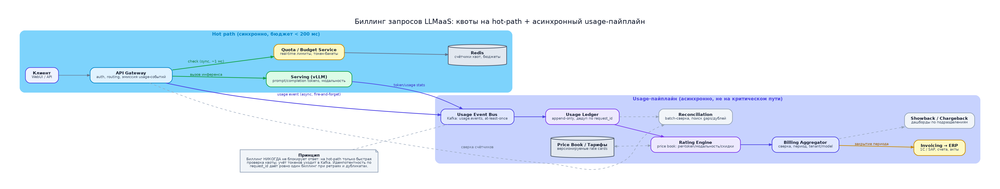
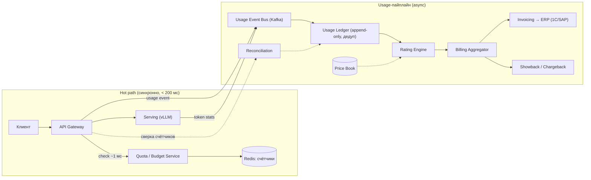

# LLMaaS — Часть 4. Биллинг запросов

**Состав отчёта (5 документов):**

1. [Постановка задачи, анализ и принципы решения](01_Постановка_задачи.md)
2. [Пропускная способность и масштабирование](02_Пропускная_способность.md)
3. [Guardrails: защита, надёжность, ресурсы и задержка](03_Guardrails_защита.md)
4. **Биллинг запросов** ← этот документ
5. [Наблюдаемость и аудит](05_Наблюдаемость_и_аудит.md)

---

## 4.1. Цели и принципы

Биллинг отвечает за **учёт использования, квоты и расчёты** между платформой и
потребителями (подразделениями/тенантами). Требуется при мультитенантности и 10 000 RPS.

**Принципы:**

1. **Биллинг никогда не на критическом пути.** На hot-path — только быстрая проверка квоты
   (~1 мс, Redis). Учёт токенов уходит **асинхронно** через брокер.
2. **Точность через идемпотентность.** Каждый запрос имеет `request_id`; дедупликация даёт
   «эффективно ровно один раз» при ретраях и дубликатах.
3. **Прозрачность (showback).** Тенант видит своё потребление в реальном времени.
4. **Аудируемость.** Все финансово значимые события — в неизменяемом ledger.
5. **Разделение** квот (enforcement, online) и биллинга (rating + invoicing, offline).

## 4.2. Единицы тарификации

| Единица | Как измеряется | Комментарий |
|---|---|---|
| Input-токены | `prompt_tokens` из usage | тариф «вход» |
| Output-токены | `completion_tokens` | тариф «выход» (дороже) |
| Модальность | изображения, секунды аудио/видео | отдельные ставки |
| Embeddings | токены/запросы | дешевле генерации |
| Запрос (per-call) | число вызовов | для моделей с фиксированной ценой |
| Приоритет | interactive / standard / batch | batch — дешевле |
| Async-задача | токены + «время в очереди» | тарификация по факту выполнения |

## 4.3. Что учитывается при расчёте

- **Cache-hit скидка:** ответ из кэша не тратит GPU → тарифицируется по льготной ставке (или
  бесплатно), но учитывается как «cache tokens» для отчётности.
- **Guardrails** могут тарифицироваться отдельной строкой (стоимость проверок) либо включаться
  в стоимость генерации.
- **Ретраи и отмены (early-abort):** отменённая до генерации задача не тарифицируется; частично
  сгенерированное — по факту доставленных токенов.
- **Отказ/деградация:** ошибки (5xx) не тарифицируются; при `429` — нет.

## 4.4. Архитектура биллинга



<sub>PNG · [SVG](diagrams/07_billing.svg) · [Graphviz .dot](diagrams/src/07_billing.dot)</sub>

<details><summary>Исходник диаграммы (mermaid)</summary>



</details>

**Компоненты:**

- **API Gateway** — эмитит usage-событие на каждый ответ (fire-and-forget).
- **Quota / Budget Service** — online-лимиты и токен-бакеты (Redis), резервирование/списание.
- **Usage Event Bus (Kafka)** — буфер учёта, at-least-once, устойчивость к всплескам.
- **Usage Ledger** — append-only, дедуп по `request_id` (ключ идемпотентности).
- **Rating Engine** — применение прайс-листа (per-token/модальность/скидки/приоритет).
- **Price Book** — версионируемые тарифные карты (rate cards).
- **Billing Aggregator** — сверка, агрегация по периоду/тенанту/модели.
- **Invoicing → ERP** — счета/акты (1С / SAP).
- **Reconciliation** — batch-сверка счётчиков квот, ledger и сырых событий.
- **Showback / Chargeback** — дашборды по подразделениям.

## 4.5. Hot-path: квоты и лимиты

Проверка квоты — единственная синхронная часть (бюджет **~1 мс**):

- лимиты: RPS (rate-limit), токены/период, бюджет (₽/мес), concurrent-запросы;
- реализация: token-bucket / счётчики в **Redis** (кластер, edge-локально);
- поведение при превышении: `429 Too Many Requests` + `Retry-After`, либо `402` при исчерпании
  бюджета; для приоритетных тенантов — мягкие пороги и предупреждения;
- «резерв/списание»: при старте запроса резервируется оценка, по завершении — фактическое списание.

## 4.6. Async usage-пайплайн

1. Gateway/Serving эмитит событие в **Kafka** (`usage.events`) — не блокируя ответ.
2. **Ledger** пишет событие с дедупом по `request_id` (повторные доставки отбрасываются).
3. **Rating** применяет прайс-лист и скидки, формирует проводки.
4. **Aggregator** агрегирует по периоду/тенанту/модели, готовит к закрытию.
5. **Invoicing** выставляет счета в ERP; **Showback** — дашборды.
6. **Reconciliation** периодически сверяет Redis-счётчики, ledger и сырые события, ищет gaps/дубли.

## 4.7. Точность, идемпотентность, сверка

- **At-least-once + дедуп** на входе в Ledger ⇒ «эффективно ровно один раз».
- **Иммутабельность:** ledger — append-only; исправления — компенсирующими (reverse) проводками,
  а не правкой истории.
- **Сверка (reconciliation):** ежедневная batch-сверка трёх источников (квоты, ledger, raw events);
  расхождения → отчёт и разбор.
- **Идемпотентные ключи** также защищают от двойного списания при ретраях клиента/шлюза.

## 4.8. Особые случаи

| Случай | Правило тарификации |
|---|---|
| Cache-hit (semantic) | льготная ставка / «cache tokens», GPU не тратится |
| Async-задача | по факту выполнения (токены + единицы времени) |
| Отмена до генерации (early-abort) | не тарифицируется |
| Частичная генерация | по доставленным токенам |
| Ошибка 5xx / `429` | не тарифицируется |
| Ретрай | дедуп по `request_id` — один раз |
| Guardrails-блок | не тарифицируется (или только стоимость проверки по политике) |
| Мультимодальность | отдельные ставки (изображение/секунда медиа) |
| Batch-приоритет | скидка относительно interactive |

## 4.9. Модель данных usage-записи

```json
{
  "request_id": "uuid",
  "tenant_id": "corp-dept-42",
  "ts": "2026-11-15T13:41:01Z",
  "model": "llama-3.3-70b-instruct",
  "modality": "text|image|audio|video",
  "prompt_tokens": 512,
  "completion_tokens": 384,
  "cached_tokens": 0,
  "priority": "interactive|standard|batch",
  "guardrail_status": "allowed|blocked|escalated",
  "latency_ms": 812,
  "rate_card_version": "2026-11",
  "cost": { "input": 0.0, "output": 0.0, "total": 0.0 }
}
```

## 4.10. Влияние на задержку и нагрузку

- **К критическому пути** добавляется только проверка квоты ≈ **1 мс**.
- Учёт токенов — **асинхронно** (Kafka), не влияет на латентность ответа.
- Брокер и пайплайн масштабируются горизонтально; при пике 10 000 RPS поток событий ≈
  10 000 событий/с — тривиально для Kafka с партиционированием по `tenant_id`.
- При недоступности пайплайна события буферизуются (Kafka retention), учёт не теряется;
  квоты остаются на hot-path (Redis) независимо.

## 4.11. Безопасность и аудит биллинга

- Финансовые события Ledger — в **неизменяемом** хранилище (WORM), доступ — отдельной роли.
- Каждое списание связано с `request_id` и `rate_card_version` — воспроизводимость расчёта.
- Изменения тарифов версионируются; смена rate card не меняет исторические проводки.
- Биллинг-события попадают в общий аудит (часть 5, «финансовые проводки»).

## 4.12. Пример тарифной сетки

| Ресурс | Ставка (условно) |
|---|---|
| Input-токены | X ₽ / 1K токенов |
| Output-токены | ~3–4× · X ₽ / 1K токенов |
| Cache-hit ответ | −70% от обычной ставки |
| Изображение (вход) | Y ₽ / изображение |
| Аудио | Z ₽ / минута |
| Embeddings | W ₽ / 1K токенов |
| Batch-приоритет | −30% |
| Guardrails (опционально) | отдельная строка |

> Ставки — иллюстративные; конкретная сетка определяется коммерческой политикой. Принципиально
> то, что модель тарификации **полностью выводится из usage-событий** и воспроизводима.
