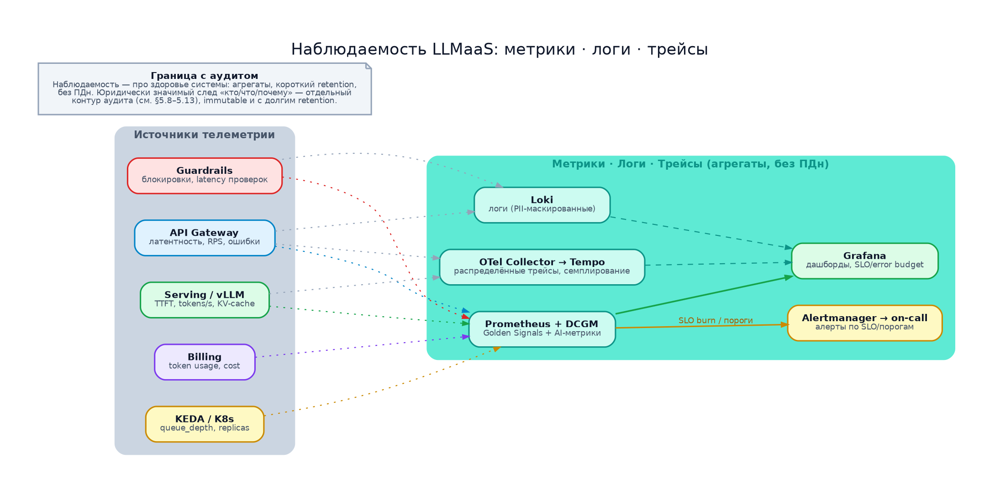
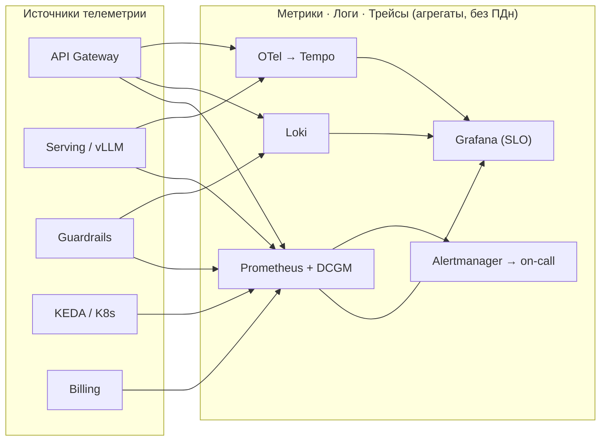
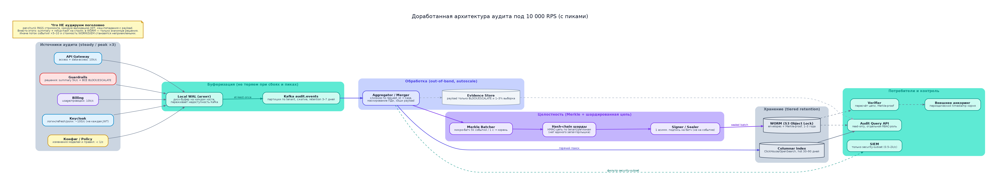
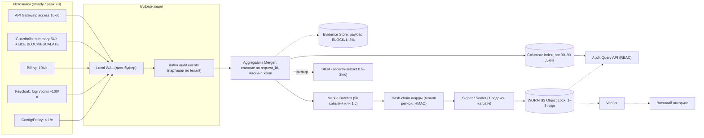

# LLMaaS — Часть 5. Наблюдаемость и аудит

**Состав отчёта (5 документов):**

1. [Постановка задачи, анализ и принципы решения](01_Постановка_задачи.md)
2. [Пропускная способность и масштабирование](02_Пропускная_способность.md)
3. [Guardrails: защита, надёжность, ресурсы и задержка](03_Guardrails_защита.md)
4. [Биллинг запросов](04_Биллинг.md)
5. **Наблюдаемость и аудит** ← этот документ

---

## 5.1. Разделение понятий

Это **две разные плоскости**, хотя питаются от одних источников:

| | Наблюдаемость | Аудит |
|---|---|---|
| Вопрос | «здорова ли система?» | «кто, что и почему сделал?» |
| Данные | метрики, трейсы, агрегаты логов | персонально-значимые события |
| ПДн | нет (агрегаты, маскирование) | есть, но маскируются; доступ ограничен |
| Retention | дни–недели | годы (по политике) |
| Изменяемость | можно чистить/вытеснять | **immutable** (WORM) |
| Потребитель | on-call, SRE, продукт | ИБ, юристы, комплаенс |

Далее: §5.2–5.7 — наблюдаемость; §5.8–5.14 — аудит.

---

## 5.2. Наблюдаемость: метрики

**Golden Signals + специфичные AI-метрики** (Prometheus + DCGM, визуализация в Grafana):

- **Latency:** p50/p95/p99 fast path; **TTFT**; **TPOT** (время на токен); latency по пулам моделей;
- **Traffic:** RPS, RPS по моделям, `tokens/s` (prompt/completion), распределение по модальностям;
- **Errors:** 5xx, `429` (load shedding), ошибки guardrails, DLQ, ошибки биллинга;
- **Saturation:** `queue_depth`, `num_requests_waiting`, KV-cache utilization, GPU/VRAM, сеть, CPU;
- **AI-специфичные:** **cache hit-rate** и `cache_false_hit_rate`, **token usage**,
  **cost per request**, доля BLOCK/ESCALATE guardrails, TTFT по пулам, длина очереди judge.

## 5.3. Логи и трейсы

- **Логи (Loki):** структурные, с `request_id`, `tenant_id`, `model`, `trace_id`; **PII-маскирование**
  обязательно; разделение access-логов и application-логов.
- **Трейсы (OTel → Tempo):** сквозной трейс запроса — edge → gateway → guardrails → serving →
  guardrails(output) → ответ; span'ы на каждый этап; семплирование (head/tail).
- **Корреляция:** единый `request_id`/`trace_id` связывает метрики, логи, трейсы и аудит.

## 5.4. Инструменты

| Назначение | Инструмент |
|---|---|
| Метрики | Prometheus (+ DCGM exporter для GPU) |
| Дашборды/алерты | Grafana + Alertmanager |
| Логи | Loki (или OpenSearch) |
| Трейсы | OpenTelemetry Collector → Tempo/Jaeger |
| LLM-трейсинг/оценка | Langfuse / LangSmith |
| Синтетика | Probe-запросы к API (проверка end-to-end и SLO) |

## 5.5. Дашборды Grafana (ключевые виджеты)

1. **Golden Signals**: Latency (p50/p95/p99), Traffic (RPS), Errors, Saturation.
2. **LLM-панель**: TTFT, TPOT, `tokens/s`, активные стримы, по моделям/пулам.
3. **Cache**: hit-rate L1/L2, `cache_false_hit_rate`, latency lookup, размер индекса.
4. **Очередь и автоскейлинг**: `queue_depth`, replicas, warm pool, время scale-up.
5. **Guardrails**: доля ALLOW/BLOCK/ESCALATE, latency проверок, время judge, деградации.
6. **Стоимость**: **cost per request**, токены, расход бюджета по тенантам.
7. **GPU/инфраструктура**: VRAM, утилизация, KV-cache, температура, питание.

## 5.6. Схема наблюдаемости

PNG · [SVG](diagrams/08_observability.svg) · [Graphviz .dot](diagrams/src/08_observability.dot)

Исходник диаграммы (mermaid)

## 5.7. SLO, error budget и алерты

| SLI | SLO |
|---|---|
| Fast path latency | p99 < 200 мс |
| TTFT | p95 < 300–600 мс |
| Доступность API | 99.9% |
| Error rate | < 0.1% |
| Cache hit-rate | > 45% |
| Guardrails availability | ≥ 99.95% |

- **Multi-window burn-rate** алерты (быстрое + медленное окно) — на SLO/error budget.
- Алерты на регрессии: рост p99, DLQ, падение hit-rate, рост false-positive guardrails,
  расхождения reconciliation биллинга.
- On-call: Alertmanager → PagerDuty/чат; отдельные severity.

---

## 5.8. Аудит: что и зачем

Аудит — **неизменяемый след** юридически и операционно значимых событий:

- **Guardrails:** каждое решение (ALLOW/BLOCK/ESCALATE) со скорами, `policy_id`, `judge_version`
  и `rationale`; режим деградации; срабатывания kill-switch.
- **Доступ:** аутентификация и роли (Keycloak: login, logout, смена ролей, отказы).
- **Действия с данными:** кто запрашивал какие данные/модели (для 152-ФЗ/GDPR).
- **Изменения конфигурации:** деплой моделей, правки политик guardrails, тарифов — с автором и
  диффом (change-log).
- **Биллинг:** финансовые проводки, применения тарифов.

## 5.9. Поток событий и ограничения, определяющие архитектуру

### 5.9.1. Поток событий аудита

Оценка для пика 10 000 RPS и **потоковых** guardrails (часть 3): проверки идут **по чанкам**, а не
один раз на ответ.

| Источник | Событий на запрос | Steady (10k RPS) | Пик ×3 |
|---|---|---:|---:|
| Access + data-access (API) | 1 | 10 000/с | 30 000/с |
| Guardrails input (на промахе кэша) | ~0.5 | 5 000/с | 15 000/с |
| Guardrails output — per-chunk | 8–12 | **40 000–60 000/с** | 120 000–180 000/с |
| Guardrails output — summary (1 на ответ) | 1 | 5 000/с | 15 000/с |
| Billing (usage/проводки) | 1 | 10 000/с | 30 000/с |
| Keycloak (логин/refresh/роли) | ~0.01 | ~100/с | ~300/с |
| Config / policy changes | ≪ | < 1/с | < 1/с |

Итого: **80 000–100 000 событий/с** «в лоб» на пике (до ~300 000/с в пике ×3); при правильном
дизайне (summary на стрим + слияние по `request_id`) — **~12 000–15 000 кейсов/с**.

### 5.9.2. Ограничения, которые архитектура обязана снять

| Ограничение «лобовой» реализации | Практический предел | Требуется на пике | Следствие для архитектуры |
|---|---|---|---|
| Единая serial hash-chain | ~5–20 тыс. соб/с | 80–100 тыс./с | батчинг + шардирование цепи |
| Асимметричная подпись на каждое событие | ~1–5 тыс. оп/с | 80–100 тыс./с | HMAC на события + подпись на батч |
| WORM PUT на каждое событие | ~3.5 тыс. PUT/с на префикс | 80–100 тыс. PUT/с | запись батчами/объектами |
| SIEM ingest 1:1 | лицензия/throughput | 80–100 тыс./с | фильтр security-subset |
| Отсутствие буферизации | — | пики и сбои | local WAL + Kafka-буфер |
| Аудит per-chunk | — | ×5–10 к объёму | summary + rollup-hash |

Именно эти ограничения, а не вкусовщина, задают состав решений ниже.

## 5.10. Архитектура аудита

PNG · [SVG](diagrams/10_audit_architecture.svg) · [Graphviz .dot](diagrams/src/10_audit_architecture.dot)

Исходник диаграммы (mermaid)

**Состав контура:**

1. **Audit-агент (SDK/sidecar)** — эмитит события из Gateway, Serving, Guardrails, Keycloak и
   Billing, не блокируя запрос.
2. **Local WAL** — диск-буфер на каждом хосте: события не теряются при недоступности Kafka.
3. **Kafka `audit.events`** — партиции по `tenant_id`, сжатие, retention 3–7 дней; поглощает пики.
4. **Aggregator / Merger** — слияние событий по `request_id` в «кейс», маскирование ПДн, хэши
   payload; автомасштабируется по числу партиций.
5. **Evidence Store** — тяжёлые payload (полный маскированный контент) только для
   `BLOCK`/`ESCALATE` и выборки 1–3%, с собственной политикой.
6. **Merkle Batcher** — сборка микро-батчей (≈5 тыс. событий / 1 с) и вычисление корня Меркле.
7. **Hash-chain шарды** — цепь по шардам (tenant/регион) на HMAC: нет единого writer'а.
8. **Signer / Sealer** — одна асимметричная подпись на батч; сeal → объект в WORM.
9. **WORM (S3 Object Lock)** — «конверты» + Merkle-proof, retention 1–3 года.
10. **Columnar index** — горячий поиск/аналитика, retention 30–90 дней.
11. **Audit Query API** — read-only, отдельная RBAC-роль.
12. **SIEM** — только security-subset (0.5–2 тыс./с).
13. **Verifier + внешний анкоринг** — периодический пересчёт цепи и фиксация корня во внешнем
    источнике доверия.

## 5.11. Обоснование архитектурных решений

Каждое решение выведено из ограничений §5.9 (нагрузка и физические пределы узлов).

| Решение | Отвергнутая альтернатива | Почему отвергнута |
|---|---|---|
| **Out-of-band + local WAL** | синхронный аудит в запросе; без буфера | аудит не должен влиять на SLO < 200 мс; пики/сбои Kafka не должны терять события |
| **Слияние по `request_id` в «кейс»** | отдельное событие на каждую активность | 40 тыс. → 15 тыс. записей/с; связность для разбора инцидента |
| **Per-chunk → summary + rollup-hash** | аудит каждого чанка стриминга | поток ×5–10 (40–60 тыс./с), взрыв стоимости WORM/SIEM |
| **Merkle-батчинг (цепь по корням)** | hash-chain на каждое событие | serial-цепь даёт ~5–20 тыс./с; батч = 1 звено на 5 тыс. событий |
| **Шардированная цепь (tenant/регион)** | единая глобальная цепь | нет единого writer'а → горизонтальная масштабируемость |
| **HMAC на события + подпись на батч** | асимметричная подпись каждого события | CPU-потолок ~1–5 тыс. оп/с несовместим с 80–100 тыс./с |
| **Envelope + Evidence Store** | всё в одном хранилище | размер/стоимость; разные retention и права доступа |
| **Tiered retention** | единый retention | WORM ~250–350 ТБ/год; hot/cold по значимости |
| **SIEM только security-subset** | ingest 1:1 | лицензия/throughput и шум; аудит ≠ SIEM-поток |
| **Verifier + внешний анкоринг** | только внутренний WORM | доказуемость целостности перед третьей стороной |

**Содержательные доводы:**

- Целостность **не требует** «цепи на каждое событие». Достаточно **доказуемой связи** между
  событиями: Merkle-дерево даёт индивидуальные **Merkle-proof**, а цепь корней — невозможность
  незаметно удалить/изменить батч. Это снимает serial-горлышко без потери гарантий.
- **Шардирование не ослабляет** связность, если каждый шард имеет собственную непрерывную цепь и
  периодический анкоринг корня: слияние цепочек при разборе делается по `request_id`/timestamp.
- Аудит **per-chunk** не нужен: для разбора достаточно **итогового решения** и **rollup-hash**
  потока; полный трейс окон хранится отдельно с коротким retention и поднимается только при
  инциденте. Так сохраняется forensics при контролируемой стоимости.
- Разделение **envelope/evidence** отражает разные режимы доступа: конверт — частый и дешёвый
  поиск; evidence — редкое, дорогое, чувствительное чтение под отдельной ролью.
- **Fail-safe потери нет**: local WAL + Kafka-retention гарантируют, что ни один значимый
  вердикт не потерян даже при пике ×3 и недоступности downstream.

## 5.12. Требования к аудиту

- **Неизменяемость:** append-only журнал + **hash-chain** (каждая запись ссылается на хэш
  предыдущей) + **Merkle-батчинг** + подпись; хранилище с **S3 Object Lock (WORM)**.
- **Retention:** сроки по политике/законодательству (годы); tiered — hot columnar, WORM-конверты,
  evidence.
- **Контроль доступа:** аудит читается **только** отдельной ролью (ИБ/аудит), read-only; запись и
  чтение — разные учётные записи.
- **Приватность:** персональные данные в аудите маскируются; хранится ровно необходимое.
- **Экспорт и интеграция:** выгрузка security-subset в **SIEM**.
- **Соответствие:** 152-ФЗ / GDPR — фиксация доступа к ПДн, минимизация, сроки хранения.

## 5.13. Ресурсы для реализации аудита

Оценка для steady 10k RPS и пика ×3.

**Объёмы данных:**

| Поток | Объём |
|---|---|
| Сырые события (до агрегации) | ~40 тыс./с ≈ 80 МБ/с (пик ~240 МБ/с) |
| Кейсы после слияния | ~12–15 тыс./с × 1–2 КБ ≈ 10–30 МБ/с |
| Записывается в WORM | ~0.7–1 ТБ/сутки (со сжатием) → **~250–350 ТБ/год** |
| Hot columnar index (30–90 дней) | ~10–30 ТБ |
| Evidence Store (BLOCK/выборка) | ~60–190 ТБ/год |

**Вычисления и сервисы:**

| Компонент | Нагрузка | Конфигурация | Кол-во |
|---|---|---|---|
| Audit-агент (sidecar/библиотека) | emit, fire-and-forget | ~0.1 vCPU на сервис-хост | по числу хостов |
| Local WAL (диск) | 80–240 МБ/с на кластер | NVMe 100–200 ГБ на хост | по числу хостов |
| **Kafka (audit.events)** | 40 тыс. msg/с, репликация ×3 | 16–24 vCPU, 64–128 ГБ, 4–8 ТБ NVMe | **3–5 брокеров** |
| **Aggregator / Merger** | 40 тыс. соб/с → 15 тыс. кейсов/с | pod 2 vCPU / 4 ГБ, autoscale | **8 (база) → 24 (пик)** |
| Merkle Batcher + Hash-chain шарды | 15 тыс. рек/с, батч 5k/1 с | 4 vCPU/шард | **8 шардов → 32 vCPU** |
| Signer / Sealer | ~2–4 подписи/с на шард | soft-HSM | 1–2 |
| **Columnar index (ClickHouse)** | 15 тыс. вставок/с | 16–32 vCPU / 64–128 ГБ узлы | **3–6 узлов** |
| WORM Storage (S3 Object Lock / MinIO) | ~20–40 МБ/с | 250–350 ТБ (сжатие) | кластер |
| Evidence Store | ~2 МБ/с | 60–190 ТБ/год | отдельный bucket |
| SIEM | 0.5–2 тыс. соб/с | по лицензии | — |
| Verifier / Anchoring | периодически | 2–4 vCPU | 1–2 |

> **Итог по ресурсам аудита:** **~100–200 vCPU и ~400–800 ГБ RAM** (Kafka + агрегатор +
> индексатор + шарды) и **хранилище**: WORM ~250–350 ТБ, hot index ~10–30 ТБ, evidence
> ~60–190 ТБ/год, Kafka NVMe ~15–40 ТБ. Это отдельный контур, **не конкурирующий** с
> GPU-инференсом по вычислениям.

**Что управляет стоимостью:** политика **retention** и доля событий, попадающих в WORM.
Снижение стоимости — за счёт агрегации (кейсы вместо событий), per-chunk → summary, tiering
(hot/cold), сжатия и фильтрации SIEM. Реализация — on-prem MinIO/S3 + ClickHouse + Kafka;
облачный WORM на 300 ТБ обходится заметно дороже.

## 5.14. Матрица: что наблюдаем и что аудируем

| Событие | Наблюдаемость | Аудит | Retention |
|---|---|---|---|
| HTTP-запрос (метрики/латентность) | да | — (access-лог с маскированием) | дни–недели |
| Решение guardrails (ALLOW/BLOCK/ESCALATE) | агрегаты | **да** (со скорами и rationale) | годы |
| Per-chunk verdict стриминга (PASS) | агрегаты | **нет** — только summary + rollup-hash | дни (columnar) |
| Per-chunk verdict при `BLOCK`/`ESCALATE` | агрегаты + трейс | **да** (полный трейс окон) | годы |
| Валидация JWT на каждый запрос | метрики | **нет** (только логин/refresh/роли) | — |
| Аутентификация / роли (Keycloak) | метрики отказов | **да** | годы |
| Изменение политик/моделей/тарифов | метрика деплоя | **да** (change-log, дифф) | годы |
| Доступ к ПДн / выгрузки данных | — | **да** (152-ФЗ) | годы |
| Финансовые проводки биллинга | cost-метрики | **да** | годы |
| GPU/инфраструктура | да (DCGM) | — | дни–недели |

## 5.15. Итог части

- **Наблюдаемость** обеспечивает видимость SLO (latency, traffic, errors, saturation + AI-метрики)
  и быструю диагностику инцидентов.
- **Аудит** даёт неизменяемый юридически значимый след по контурам: безопасность (guardrails),
  доступ (Keycloak), данные (152-ФЗ), изменения и биллинг.
- Архитектура аудита **выведена из нагрузки 10 000 RPS и пиков**: out-of-band + local WAL,
  агрегация по `request_id`, per-chunk → summary, **Merkle-батчинг**, **шардированная цепь**,
  HMAC + редкая подпись, envelope/evidence и tiered retention.
- Стоимость реализации — **~100–200 vCPU**, ~400–800 ГБ RAM и **~250–350 ТБ WORM**; обоснование
  каждого решения — в §5.11.
